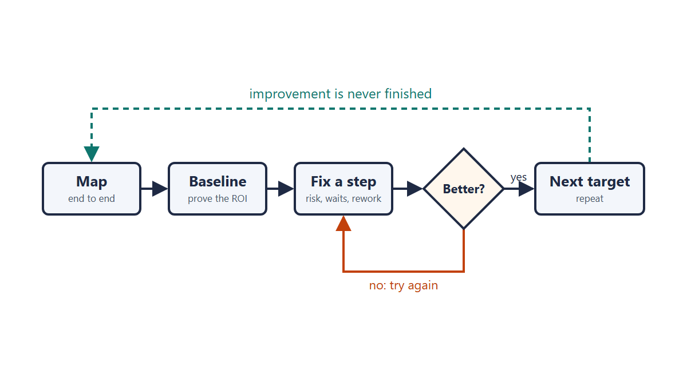
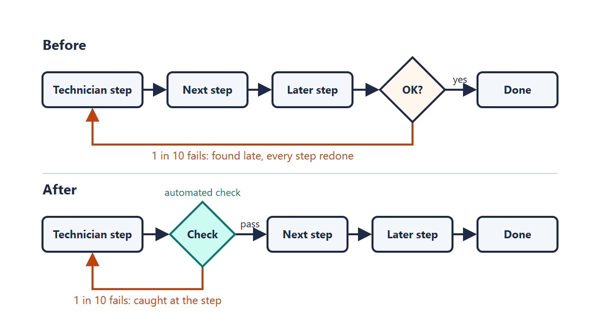

The same string of interviews that led to [How I Build Tools](../Tooling_2026/index.qmd) had a second question I liked: how do I approach automation and continuous improvement overall? That post covers how one tool gets built. This one covers how I decide what is worth building in the first place.

{fig-alt="A process flow: map, baseline, fix a step, then a gate asking whether it is better, with a rework loop back to the fix and a dashed loop back to the start labeled improvement is never finished"}

## Map it end to end

I start by finding a large, convoluted process and breaking it into its discrete steps, from start to finish. It does not matter whether the fix ends up being physical, hardware, or software. For each step I want to know how long the work takes, how long it waits, and whether it can send work backward. Every rework loop becomes a yes/no gate with a percentage on it.

I built the [Process Flow Mapper](https://tools.jesse-anderson.net/tools/process-flow-mapper.html) to do this. You type in the steps, the times, and the gate percentages, and it gives back lead time, first-pass yield, and where the time goes.

## Get a baseline

The map is also the baseline, and I always start with one. It is what proves the ROI to the people above you, and it is the only way to show that a change did anything.

Often nobody has any data. If I am lucky, I can interview the people who do the work. If I am not, I sit with them for a few hours and watch the process myself. I am not above hanging around with people wrenching.

## Act on limited data

I have wasted time in the exploratory data gathering phase before. I am more mindful now of always trying to act while I collect, even when the data is limited.

That is easier in 2026 than it has ever been. LLMs, computer vision, cheap or free cloud resources, and cheap embedded devices mean you can spin something up as a test drive, or just to start collecting data. There is not much of an excuse nowadays to not experiment.

## Earn trust, then pick targets

If the social capital is not there yet, I build it with quick wins, 80/20 style. In office work that is usually somebody manually doing something that should have been automated decades ago. Those are the easy ones. After that I target what the team gives me.

When the choice is mine, the order is:

1. **Highest risk or cost of error.** A rare mistake that is expensive or dangerous goes first.
2. **Biggest wait or lead time.** Waiting is wasted human time, and it is usually where most of the calendar goes.
3. **Worst rework loop.** This comes last only because it is the hardest to get support for. People accept rework as part of the process.

That acceptance is part of the problem. Rework and waste get treated as the way things are, when they belong on the to-do list. Improvement is never finished, because the process and the constraints around it keep changing.

## When I leave it alone

I decide not to automate when there is a regulatory hurdle, or when the office political stakes are significant.

When people resist a change, I sit down with them and explain how much easier their lives will be with the tooling. At the end of the day I am tasked with changing the tooling and drafting the SOP for it. Convincing people is a different job, and it deserves its own article.

## Fix the process, not the person

The harder problems are faults inside a system. Say a technician gets a step wrong one time in ten, and each miss forces rework. The usual response is to harass the technician. That does not last, and it treats a process problem as a personal one.

I would rather add an automated check at that step: computer vision, a data check, or something similar that catches the error before it moves downstream.

{fig-alt="Two process flows. Before: a technician step, two more steps, then an OK gate whose 1 in 10 failures loop all the way back to the technician step. After: an automated check sits right after the technician step, so the 1 in 10 failures loop back only one step."}

This is the Taguchi idea. You do not try to eliminate every source of variation. You design the process so that the variation stops affecting the result.

## Keep people where it counts

I purposely work slower on automations to avoid faults, and I fix the process incrementally so each change can be measured against the baseline.

How much oversight stays depends on the stakes. When safety or a fair amount of capital is involved, a human stays on it. When there is no risk of injury or loss of life and the stakes are relatively low, a fast weekly or monthly check-in on the process is enough.

The subject matter experts guide all of it. They know the work and should always be consulted, and a lot of the job is turning what they know into a repeatable process flow. I sit down with them when they have time. It can be rough to tie up what little they have, so if things are truly hectic we go to lunch, or we walk and talk. If I am lucky, they describe the process out loud while I frantically write it down in a small paper notebook.

## What the saved time is for

This approach has saved thousands of hours a year on software tasks across several organizations. In a trades-oriented field, it cut waste disposal costs by 90% and field ticketing time by 50%.

The bigger payoff is often a side effect. Senior engineers get freed up for harder work, and the team gets the bandwidth to think about what else could be improved, so one fix leads to the next.

It does not always go that way. Automation can also be used as a justification to cut people, or to throw more work on the ones who are left. I do not agree with either. Having more capacity to accomplish more should not result in people being punished for it.
