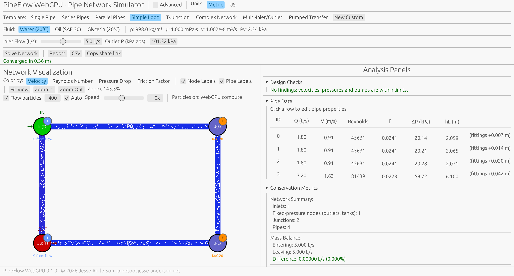
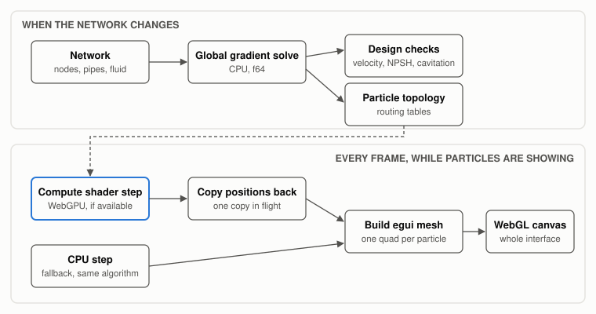
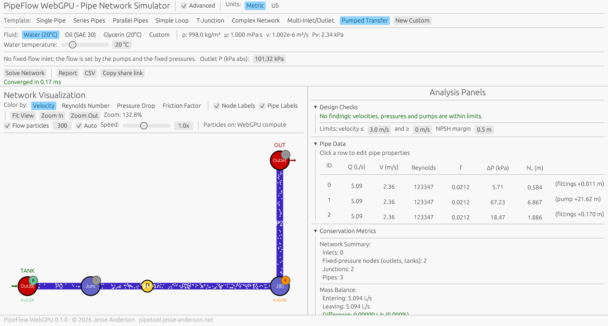
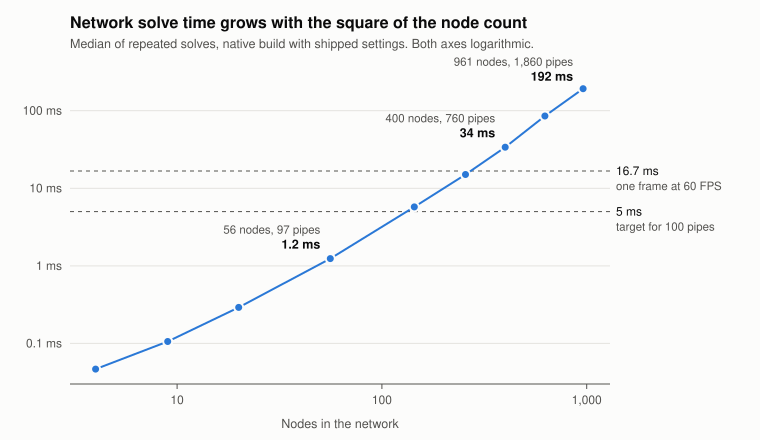
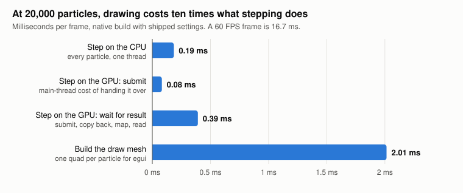

```{=html}
<!--
-->
```

```{=html}
<style>
/* Keep wide equations and tables from making the whole page scroll sideways on a phone */
mjx-container[display="true"] { overflow-x: auto; overflow-y: hidden; max-width: 100%; }
@media (max-width: 700px) { main table { display: block; overflow-x: auto; } }
</style>
```

*Disclaimer: Please note that the information presented in this article is for informational purposes only. It is not intended to serve as health advice, engineering advice, or any form of professional guidance. Readers should consult with qualified professionals for specific health or engineering concerns and should not rely solely on the content of this article for making decisions. The authors and publishers of this article are not responsible for any actions taken based on the information provided herein.*

**Live tool: <https://pipetool.jesse-anderson.net>**

A pipe network solver in Rust, compiled to WebAssembly, with flow particles on WebGPU. This article covers the equations it solves and why each was chosen, the first solver that passed its tests while returning its own starting guess, how the replacement is checked against EPANET and SciPy, and measurements showing where the GPU does and does not earn its place.

**TL;DR**

-   PipeFlow is a free pipe network solver that runs in the browser: Rust compiled to WebAssembly, no backend, nothing uploaded.
-   The first version's solver passed its tests while returning its own starting guess. The tests checked that numbers fell inside wide bands; none compared against an answer from somewhere else. TLDR TLDR; my tests sucked.
-   The replacement is the global gradient method, the one EPANET uses. It agrees with an independent SciPy solve to five digits and with EPANET to within 0.3% on flows and 0.6% on heads.
-   Losses use Colebrook-White solved to convergence, Hooper 2-K for elbows and valves, Crane TP-410 for tees, and Borda-Carnot for expansions, all on total head. Section 3 has the equations and a pipe worked by hand.
-   A 97-pipe network solves in 1.2 ms natively and about 5 ms in the browser. On a desktop with an RTX 3090 the browser holds 60 FPS with 20,000 particles on a small network.
-   The WebGPU compute shader is not what makes it fast. The GPU and CPU particle paths ran at the same frame rate at every size I tried; the time goes to drawing.
-   It is an MVP. Section 12 is what it is an MVP for.

**Table of Contents**

1.  [Introduction](#Section1)
2.  [What It Does](#Section2)
3.  [The Equations](#Section3)
4.  [The First Solver](#Section4)
5.  [The Global Gradient Method](#Section5)
6.  [The Loss Model](#Section6)
7.  [Checking It Against Things I Did Not Write](#Section7)
8.  [Where the GPU Ended Up](#Section8)
9.  [Performance, Measured](#Section9)
10. [Keeping It Mine](#Section10)
11. [What It Does Not Do](#Section11)
12. [What Is Next](#Section12)
13. [Building It](#Section13)
14. [Conclusion](#Section14)
15. [References](#Section15)

## 1. Introduction {#Section1}

PipeFlow is a pipe network simulator that runs in a browser tab. You draw a network or pick a template, choose a fluid and a flow, and it solves for the flow, velocity and pressure in every pipe, then shows the result with particles moving through the pipes at the speed the fluid actually moves.

I built it for myself. There are plenty of fluids tools out there, but paying for a license to do a one-off calculation makes no sense to me, so what I generally do is calculate by hand and then pray I am close enough. Sizing the inlet and outlet pipes for a given flow is the usual case. It generally ends up in a spreadsheet, but I really like web apps, and I wanted one I could reach for on those one-off jobs and keep expanding as the work calls for it.

It sat on the back burner for most of a year. The first commit with code in it is from January and its message is "webGPU Hell," which was an accurate summary. I have now put the finishing touches on it, and "finishing" needs qualifying: this is an MVP, and Section 12 is the list of what it is an MVP *for*.

This post is less about the features than about one finding. In January a cursory once-over seemed to show it was good enough. The tests passed. But doubt remained: I had not had time to validate anything properly, and what I was working with was a skeleton of sorts. When I finally did validate it, the network solver was returning its initial guess.

The rest of the post is what was wrong, what replaced it, how I now know the answers are right, and an honest account of where the GPU helps. That last part is shorter than the project's name suggests.

### Who It Is For

Two audiences share one app:

-   **Engineers doing a sizing check.** An "Advanced" toggle adds editable nodes and pipes, ASME pipe sizes, water at any temperature, pumps with curves and NPSH, design limits, Metric or US units, a printable report and share links.
-   **Students of fluid mechanics.** Templates, one fluid picker, one flow slider, and Reynolds number, friction factor and mass and energy balances that update as you drag. A "Worked Calculation" panel writes out the arithmetic for any pipe, step by step.

The rule I held to: a new control goes behind the Advanced toggle unless a student needs it.

{fig-alt="The PipeFlow app showing a rectangular loop of four pipes with white tracer particles in each, a pipe data table listing flow, velocity, Reynolds number, friction factor, pressure drop and head loss for each pipe, and conservation metrics showing a mass balance difference of zero."}

## 2. What It Does {#Section2}

| Area       | What is modeled                                                                                                              |
|------------------------------------|------------------------------------|
| Flow       | Steady, incompressible, single-phase. Any topology: branches, loops, several inlets and outlets, reversed flow               |
| Friction   | Darcy-Weisbach, with Colebrook-White solved to convergence; 64/Re in laminar flow                                            |
| Fittings   | Hooper 2-K for elbows and valves; Crane TP-410 for tees and wyes; sudden expansions and contractions from the pipe diameters |
| Pumps      | Two-point curve or a table of 3 to 8 points, affinity-law speed changes, check valve, NPSH available                         |
| Boundaries | Fixed inflows, fixed-pressure outlets, open tanks                                                                            |
| Fluids     | Water from 0 to 100 °C, preset oils, or entered properties                                                                   |
| Checks     | Velocity limits, pressure below vapor pressure, pump off its curve, NPSH margin                                              |

The whole thing is about 23,000 lines of Rust including tests. The browser download is 2.8 MB of WebAssembly, 1.4 MB gzipped. Nothing is uploaded and there is no backend: a share link is the network itself, encoded into the URL fragment.

### Why This Stack

A spreadsheet would do these sums. Honestly, the draw was simply getting more familiar with WebGPU. My Rust regression library, [linreg-core](https://blog.jesse-anderson.net/posts/linreg_core_XLL/), is not as optimized as I would like it to be, and eventually I want something like GPU computing or parallelization in its engine to make it competent. I am fine with just using an off-the-shelf library for that, but that is a future problem. This project was a place to learn the machinery first, and Sections 8 and 9 are what I learned.

The other half is the web itself. I like its openness, and I like not having to install a complicated chain of dependencies which break all the time. Looking at you, Python.

I was likely a bit excessive in reaching for Rust and WebAssembly. But I did not want to write a bunch of JavaScript only to run into the language itself being the inefficient part. And more than anything, this project was just meant to keep the engineering brain going.

### One Codebase, Two Targets

The January version had a Rust physics core and a JavaScript interface: vanilla JS, an HTML canvas, Chart.js for plots, and JSON passed across the WebAssembly boundary. The interface is where I could not test anything. A wrong label or a unit mix-up on the JavaScript side was invisible to `cargo test`.

The interface is now Rust too, written with egui. The same code builds as a native desktop app and as the browser app, and interface logic is covered by the same test run as the physics. The old JavaScript is still sitting in the project with `.deprecated` on the end of each file name.

{fig-alt="Data flow diagram. When the network changes: the network goes to a global gradient solve on the CPU in f64, which feeds design checks and the particle routing tables. Every frame while particles are showing: particles step in a WebGPU compute shader and positions are copied back, or they step on the CPU as a fallback; either way an egui mesh of one quad per particle is built and drawn to a WebGL canvas."}

Two graphics APIs are in play, and they do not talk to each other. egui draws the whole interface through WebGL, which every browser has. A separate WebGPU device, requested in the background after the page loads, runs only the particle compute shader. If that request fails, the particles step on the CPU and nothing else changes. The app never requires WebGPU.

## 3. The Equations {#Section3}

Everything the solver does is two conservation laws and one empirical relation. They fit on a page, and the rest of this post keeps referring back to them.

### Two Laws

**Mass.** At every node that is not a fixed-pressure outlet, what flows in flows out. With $q_i$ the external inflow at node $i$:

$$
\sum_{j \,\in\, \text{out}(i)} Q_j \;-\; \sum_{j \,\in\, \text{in}(i)} Q_j \;=\; q_i
$$

Where:

-   $Q_j$ is the flow in pipe $j$, in m³/s. It is signed: positive when the fluid runs from the pipe's start node to its end node, the way the pipe was drawn.
-   $\text{out}(i)$ is the set of pipes that start at node $i$, and $\text{in}(i)$ is the set that end there.
-   $q_i$ is the flow entering the network from outside at node $i$: the set flow at an inlet, and zero at a plain junction.

**Energy.** Along every pipe, the fall in total head equals the head lost to friction and fittings, less anything a pump adds:

$$
H_{\text{start}} - H_{\text{end}} = h_j(Q_j), \qquad H = \frac{P}{\rho g} + z + \frac{V^2}{2g}
$$

Where:

-   $H$ is the total head at a node, in meters of the fluid. $H_{\text{start}}$ and $H_{\text{end}}$ are its values at the two ends of pipe $j$.
-   $h_j(Q_j)$ is the head-loss law of pipe $j$: the head it takes to push flow $Q_j$ through it, in meters.
-   $P$ is the static pressure in Pa, absolute.
-   $\rho$ is the fluid density in kg/m³, and $g$ is 9.81 m/s².
-   $z$ is the elevation above a common datum, in meters.
-   $V$ is the mean velocity in the pipe, in m/s.

A network with $N$ unknown heads and $M$ pipes has $N$ of the first equation and $M$ of the second, for $N + M$ unknowns. The first set is linear. The second is not, and that is the whole difficulty.

### One Empirical Relation

The head loss in a pipe is Darcy-Weisbach plus fittings:

$$
h(Q) = \left(f\,\frac{L}{D} + K\right)\frac{V\,|V|}{2g}, \qquad V = \frac{Q}{A} = \frac{4Q}{\pi D^2}
$$

Where:

-   $f$ is the Darcy friction factor, a pure number.
-   $L$ and $D$ are the pipe's length and inside diameter, in meters.
-   $K$ is the sum of the loss coefficients of the fittings charged to this pipe, also a pure number. Section 6 is about where it comes from.
-   $A$ is the pipe's cross-sectional area in m².
-   $V^2/2g$ is the velocity head: the height the fluid's own speed could lift it.

$V|V|$ in place of $V^2$ is deliberate. It makes the loss change sign with the flow, so a pipe that turns out to flow backwards gives a head *rise* from start to end and nothing has to be special-cased. The January code handled reversed flow by producing a negative friction factor.

The friction factor $f$ depends on the Reynolds number and the relative roughness:

$$
Re = \frac{V D}{\nu}, \qquad
f =
\begin{cases}
\dfrac{64}{Re} & Re < 2300 \\[2ex]
\text{linear in } Re \text{ between the two ends} & 2300 \le Re \le 4000 \\[1ex]
\text{Colebrook-White} & Re > 4000
\end{cases}
$$

Where:

-   $Re$ is the Reynolds number, the ratio of inertia to viscous drag in the flow. It is a pure number.
-   $
u$ is the kinematic viscosity of the fluid in m²/s: 1.0 × 10⁻⁶ for water at 20 °C, and about 300 times that for SAE 30 oil.
-   $f$ is the friction factor from the head-loss equation above.

The middle branch runs in a straight line from $64/2300$ to the Colebrook-White value at $Re = 4000$. Colebrook-White is implicit in $f$:

$$
\frac{1}{\sqrt{f}} = -2\log_{10}\!\left(\frac{\varepsilon/D}{3.7} + \frac{2.51}{Re\sqrt{f}}\right)
$$

Where:

-   $\varepsilon$ is the absolute roughness of the pipe wall in meters: 0.045 mm for commercial steel.
-   $\varepsilon/D$ is the relative roughness, a pure number.
-   $f$ appears on both sides, which is why this has to be solved and cannot just be evaluated.

The laminar branch is not empirical. Substituting $f = 64/Re$ into Darcy-Weisbach gives Hagen-Poiseuille, which is exact:

$$
h = \frac{128\,\nu\,L}{\pi\,g\,D^4}\,Q
$$

Linear in $Q$, and fourth power in diameter. Both facts come back later.

### One Pipe, By Hand

100 m of 50 mm commercial steel pipe ($\varepsilon$ = 0.045 mm) carrying 5 L/s of water at 20 °C ($\nu = 1.002 \times 10^{-6}$ m²/s, $\rho$ = 998 kg/m³):

| Step               | Calculation                                 | Result       |
|------------------------|------------------------|------------------------|
| Area               | $\pi (0.05)^2 / 4$                          | 0.0019635 m² |
| Velocity           | $0.005 / 0.0019635$                         | 2.5465 m/s   |
| Reynolds number    | $2.5465 \times 0.05 / 1.002 \times 10^{-6}$ | 127,070      |
| Relative roughness | $0.045 / 50$                                | 0.0009       |
| Friction factor    | Colebrook-White                             | 0.02135      |
| Velocity head      | $2.5465^2 / (2 \times 9.81)$                | 0.3305 m     |
| Head loss          | $0.02135 \times (100/0.05) \times 0.3305$   | 14.112 m     |
| Pressure drop      | $998 \times 9.81 \times 14.112$             | 138.2 kPa    |

This is the calculation the app's "Worked Calculation" panel writes out for any pipe you click. It is also the single-pipe validation case from my own specification, where I had written down $f = 0.0200$ and $\Delta P = 129.7$ kPa as the expected answer.

Those are wrong, and how they are wrong is instructive. I had used the Swamee-Jain explicit approximation,

$$
f = \frac{0.25}{\left[\log_{10}\!\left(\dfrac{\varepsilon/D}{3.7} + \dfrac{5.74}{Re^{0.9}}\right)\right]^2}
$$

which for this pipe gives 0.0215, within 0.7% of Colebrook. The formula was not the problem. The specification evaluates $5.74/Re^{0.9}$ as 0.0000493. It is 0.000146. That one slip turns the squared logarithm from 11.63 into 12.49 and the friction factor from 0.0215 into 0.0200, an expected answer 6% low. (The specification also rounds the velocity to 2.55 m/s before computing the Reynolds number, which is why it has 127,245 where the table above has 127,070. That one is harmless.)

In fairness to the slip, 6% is honestly not too bad. When I do this by hand I generally read the friction factor off a Moody chart, and I expect eyeballing things like that to be 10% off at a minimum. For the back of an envelope that is fine. It stops being fine when the number is written down as the expected answer a solver gets tested against.

Add one standard 90° elbow to that pipe and it costs another $0.61 \times 0.3305 = 0.20$ m. Where the 0.61 comes from is Section 6.

## 4. The First Solver {#Section4}

The January version used Hardy-Cross for looped networks and a separate direct solver for trees. I had not used Hardy-Cross before. I was googling around, just looking at methods, and found it; I could not find it in my BSL or in my Çengel and Cimbala. It is the classic hand method for looped networks: guess flows that satisfy continuity, then walk each loop and correct the flows until the head losses around the loop sum to zero. Honestly, the exercise reminds me of electrical engineering coursework, trying to figure out the resistors and other components in a network flowing from A to B.

Mine did not do that. It did this:

-   **The loops were oriented wrong.** The closing pipe of each loop was traversed in the same direction as the tree path it was supposed to oppose. The corrections therefore drove loop flows toward zero, and the solver reported convergence when they got there.
-   **A "continuity enforcement" step hid it.** After the loop corrections, the flows were rescaled back up to match the inlet flow. That made the output look plausible and leaked mass at the junctions.
-   **Tree networks split flow by D².** Not by length, roughness, elevation or outlet pressure. Two branches of the same diameter got the same flow whether one was 10 m long or 1,000. The equations in Section 3 say what the split should be. Two branches between the same pair of pressures share the same head difference, so in laminar flow $Q \propto D^4/L$, and in fully turbulent flow $h \propto f L Q^2 / D^5$ gives $Q \propto D^{2.5}/\sqrt{fL}$. Splitting by $D^2$ is splitting by area, which is assuming every pipe has the same velocity. For the 10 m and 1,000 m pair the right answer is about ten to one in turbulent flow and a hundred to one in laminar flow, not one to one.
-   **The elevation term in node pressure had the wrong sign.** A validation test asserted the same wrong sign.
-   **Minor losses were bookkeeping only.** They were added to `head_loss` but not to `pressure_drop`, so a globe valve changed neither the flows nor the pressures. A node's K was also charged to every pipe touching it.
-   **Reversed flow produced a negative friction factor**, and zero flow produced NaN.

### Why the Tests Passed

None of them compared a solved network against an answer obtained some other way. They checked that numbers landed inside bands, and the bands were wide. Two examples from the January commit:

-   **The single-pipe case** carried a comment noting that the specification's 0.0200 was a hand-calculation error and the right value was about 0.0213. It then accepted any friction factor from 0.020 to 0.022 and any pressure drop from 130 to 145 kPa.
-   **The parallel-pipe case** exists to check one thing: two pipes in parallel have the same pressure drop. The assertion allowed the two to differ by up to 100%, with a comment that a proper solution would need an iterative solve.

A test that asserts the code's current output is a regression test. It will tell you when something changes. It cannot tell you whether the thing was right to begin with, and a validation test that shares the code's sign error is worse than no test, because it turns a bug into a requirement.

So a quick look in January said the thing was fine, and the quick look was reading tests like these. The doubt I was left with was the accurate part. Realistically, in defense of my earlier decisions, I was working with a skeleton and close enough before hammering in numerical preciseness almost always works out for me. Tol = 1E-3 vs 1E-6 vs 1E-9 if we are talking engineering tolerances for numerical convergence.

### What Else Was Broken

The solver was not the only casualty. The Swamee-Jain exponent in the shader was 0.09 where it should have been 0.9. The browser build could not start, because `index.html` imported a `start` function that did not exist. And wgpu 0.19 could no longer create a WebGPU device in current Chrome at all, because it requests a limit Chrome has since removed. Always look at the most up to date version of libraries I guess.

The interface had its own: the inlet flow slider showed m³/s under a label that said L/s, a factor of a thousand, and node and pipe ids were being used as array indices, which worked until the first time someone deleted a node.

## 5. The Global Gradient Method {#Section5}

The replacement is the global gradient method of Todini and Pilati, the same method EPANET uses. It has one property that matters more than its convergence rate: trees, loops, multiple inlets and outlets and reversed flow all go through one code path. The solver never needs to know what a loop is, so there is no loop orientation to get backwards, and no special case for trees.

I did not arrive at it by knowing better. It turned up the same way Hardy-Cross had, by searching. I had not heard of EPANET before this project either.

The unknowns are the total head $H_i$ at every node and the signed flow $Q_j$ in every pipe. Each pipe has a head-loss law $h_j(Q_j)$. Linearize it about the current flow:

$$
Q_j^{\text{new}} = Q_j - \frac{h_j(Q_j) - (H_{\text{start}} - H_{\text{end}})}{h_j'(Q_j)}
$$

This is one Newton step on the pipe's energy equation, with the heads left as unknowns. Write $p_j = 1/h_j'(Q_j)$ and $b_j = Q_j - p_j\,h_j(Q_j)$, so that

$$
Q_j^{\text{new}} = b_j + p_j\,(H_{\text{start}} - H_{\text{end}})
$$

Where:

-   $Q_j$ is the current estimate of the flow in pipe $j$, and $Q_j^{\text{new}}$ is the next one.
-   $h_j'(Q_j)$ is the slope of the head-loss law at the current flow: meters of head per m³/s.
-   $H_{\text{start}}$ and $H_{\text{end}}$ are the total heads at the two ends of the pipe. They are not known yet; this iteration is about to solve for them.
-   $p_j$ is the inverse of that slope, in m³/s per meter of head. It says how much more flow the pipe passes for one more meter of head across it, which makes it a conductance.
-   $b_j$ is the flow the linearized pipe would carry with no head difference across it. It has no physical meaning on its own; it is the intercept of the straight line.

Substitute that into the mass balance at every node that is not a fixed-pressure outlet, and the flows drop out. For node $i$, with $n(j)$ the node at the other end of pipe $j$:

$$
\Big(\sum_{j \ni i} p_j\Big) H_i \;-\; \sum_{j \ni i} p_j\,H_{n(j)} \;=\; q_i \;-\; \sum_{j \,\in\, \text{out}(i)} b_j \;+\; \sum_{j \,\in\, \text{in}(i)} b_j
$$

Where:

-   $H_i$ is the unknown total head at node $i$.
-   $j \ni i$ means every pipe $j$ with node $i$ at one of its ends.
-   $n(j)$ is the node at the other end of pipe $j$.
-   $q_i$, $\text{out}(i)$ and $\text{in}(i)$ are as in the mass balance of Section 3.

Where $H_{n(j)}$ belongs to an outlet it is known, and moves to the right-hand side. What is left is one linear system $\mathbf{A}\,\mathbf{H} = \mathbf{r}$ for the unknown heads. Solve it, compute the new flows from the new heads, repeat.

$\mathbf{A}$ has a familiar shape. The diagonal entry for a node is the sum of $p_j$ over its pipes, and the off-diagonal entry for two connected nodes is $-p_j$. That is the Laplacian of the network graph, weighted by how easily each pipe passes flow, with the outlet rows and columns removed. It is the same matrix as a resistor network with conductances $p_j$, so the electrical engineering feeling from Section 4 turns out to be exact. That is not a coincidence: one iteration of this method *is* solving a resistor network with current sources, and the next iteration updates the resistances.

Two consequences follow. $\mathbf{A}$ is symmetric and positive definite as long as every $p_j > 0$ and every node can reach an outlet, so the linear solve cannot fail on a sensible network. And $p_j > 0$ needs $h_j' > 0$: head loss must rise with flow. Friction and fittings always satisfy that. A pump does only if its curve never rises with flow, which is why Section 6 is fussy about how pump curves are interpolated. (The code also floors $h_j'$ at a tiny positive number, so a bad curve cannot produce a negative conductance. The arithmetic stays finite, though the answer from a curve like that would still be meaningless.)

The assembly is short enough to show:

``` rust
let q = flows[j];
let h = head_loss(pipe, q, &losses[j]);
let dq = (q.abs() * 1e-6).max(1e-12);
let gradient =
    (head_loss(pipe, q + dq, &losses[j]) - head_loss(pipe, q - dq, &losses[j])) / (2.0 * dq);
let p = 1.0 / gradient.max(1e-14);
inv_gradient[j] = p;
base_flow[j] = q - p * h;

if let Some(row) = unknown[start] {
    matrix[row * n_unknown + row] += p;
    match unknown[end] {
        Some(col) => matrix[row * n_unknown + col] -= p,
        None => rhs[row] += p * heads[end],
    }
    rhs[row] -= base_flow[j];
}
```

Three decisions in there are worth explaining.

### The Gradient Is Numerical

The full head-loss law the solver differentiates is

$$
h_j(Q) = \Big(\underbrace{f\,\frac{L}{D}}_{\text{friction}} + \underbrace{K_c + \frac{K_1}{Re} + K_\infty\Big(1 + \frac{1}{D_{\text{in}}}\Big)}_{\text{fittings}}\Big)\frac{V|V|}{2g} \;+\; \underbrace{\Delta h_{\text{tee}}}_{\text{tee}} \;-\; \underbrace{H_{\text{pump}}(Q)}_{\text{pump}}
$$

Where:

-   $K_c$ is the sum of the fixed coefficients on this pipe: a sudden expansion or contraction, the velocity head given up at an outlet, any fitting Hooper does not tabulate, and any K the user typed in.
-   $K_1$ and $K_\infty$ are Hooper's two constants, summed over the elbows and valves charged to this pipe, and $D_{\text{in}}$ is the pipe's inside diameter in inches. Section 6 has the method.
-   $\Delta h_{\text{tee}}$ is the head change across a tee or wye at one end of the pipe, in meters. It is set by the velocity in the tee's combined leg, not by this pipe's own velocity, which is why it sits outside the bracket.
-   $H_{\text{pump}}(Q)$ is the head added by a pump on this pipe, in meters, and zero if there is none.
-   Everything else is as in Section 3.

That is not a formula I can differentiate by hand once and forget. $f$ is a Colebrook solve, the fitting coefficient depends on Reynolds number, and $H_{\text{pump}}$ may be a monotone cubic through a table. An analytic derivative would have to be rewritten every time I add a loss term, and a wrong derivative fails quietly: Newton usually still converges, only slower, and nothing tells you why.

A central difference costs two extra head-loss evaluations per pipe per iteration and cannot drift out of step with the function it differentiates. Section 9 shows what that costs, and it is not much.

One term is not differentiated at all. $\Delta h_{\text{tee}}$ depends on the flow split at the tee, which involves other pipes. It is recomputed from the current flows at the top of every iteration, along with which pipes discharge to an outlet and which way each diameter change faces, and then held fixed while the pipes are linearized. That lag is one reason the iteration needs damping.

### Continuity Holds From the First Iteration

The starting guess is 0.3 m/s along each pipe's drawn direction. It is a bad guess, and it does not matter, because the linear solve enforces continuity at every node on every iteration. Only the energy equation is being iterated on. There is no continuity step to add afterward, which is where the January solver went wrong.

### Convergence Needs Two Things

The January solver stopped when the flows stopped changing. Flows also stop changing when you have driven them to zero.

The new one requires the largest flow change to be negligible *and* the largest energy residual $|h(Q) - \Delta H|$ across all pipes to be negligible:

``` rust
if flows_settled && max_residual <= 1e-10 + 1e-7 * head_scale {
    converged = true;
    break;
}
```

If the flow change grows from one iteration to the next, the step is halved, down to a floor of 5%, and allowed to recover when the iteration is contracting again. This matters for the tee correlations in Section 6, which have small steps in them.

The solve runs in f64. Results are stored as f32, which is one of the open items.

### What Makes a Network Solvable

The matrix argument earlier in this section has a condition in it: every node can reach an outlet. It is worth saying why, because it decides what the boundary conditions have to be.

There are two kinds of boundary. An **inlet** fixes a flow into the network. An **outlet** fixes a pressure, and so a head:

$$
H_{\text{outlet}} = \frac{P_{\text{set}}}{\rho g} + z
$$

Where:

-   $P_{\text{set}}$ is the pressure the outlet is set to, in Pa absolute: 101,325 for a discharge to atmosphere.
-   $z$ is the elevation of the outlet, or of the liquid surface if it is a tank.

Every equation in Section 3 involves heads only as differences. Add ten meters to every head in the network and every equation still holds. Flows alone can never pin down the pressure level, so a network with only inlets has infinitely many solutions, and its matrix is singular: the rows of an untouched graph Laplacian sum to zero. One fixed-pressure node removes that freedom for everything connected to it.

So before assembling anything, the solver walks outward from the outlets. If any node with a pipe attached is not reached, it reports the network as unsolved instead of handing a singular matrix to the elimination.

The same reasoning is why an open tank needs no new machinery. A tank is a fixed-pressure node at atmospheric pressure whose elevation is the liquid surface. Nothing in the math says flow must *arrive* at a fixed-pressure node, so a tank can supply flow as well as receive it, and a network can have no inlet at all: tank, pump, higher tank is solved for its flow. The canvas labels such a node TANK when it turns out to supply and OUT when it receives.

{fig-alt="The PipeFlow app in Advanced mode showing a tank, a pump and a higher outlet joined by three pipes. A note reads: no fixed-flow inlet, the flow is set by the pumps and the fixed pressures. The pipe table shows 5.09 L/s in every pipe and a pump adding 21.62 m."}

## 6. The Loss Model {#Section6}

Once the solver was right, the loss model was the next thing wrong with the answers. Each of these came from asking what a single fixed K per fitting gets wrong.

Crane TP-410 is the reference, and I am not going to comment on the fittings themselves. If the math shows something to be true, then it is true in the simulation, and that is all I am claiming. Simulations can be garbage, and should be treated as a high-level overview as opposed to the ground truth of any system.

### Total Head, Not Static Head

Node heads are total heads, $H = P/\rho g + z + V^2/2g$. Total head is continuous through a junction apart from the fitting loss there, so where the diameter changes, static pressure moves with the velocity head. An outlet fixes the static pressure of the stream leaving, which means a pipe discharging to an outlet gives up its velocity head there. In the solver that is one line: a pipe whose flow discharges into an outlet gets $K = 1$ added. It goes by the direction the flow turned out to have, not the direction the pipe was drawn.

Going the other way, the pressure the app reports at a node is static pressure, recovered from the total head:

$$
P = \rho g\,(H - z) - \tfrac{1}{2}\rho V^2
$$

Where:

-   $P$ is the static pressure reported at the node, in Pa absolute.
-   $H$ is the node's total head from the solve, and $z$ is its elevation.
-   $V$ is the velocity in the pipe carrying the most flow at that node.

Where pipes of different velocity meet, each has its own static pressure, and the node reports the one in the pipe carrying the most flow. A 40 mm pipe expanding to 80 mm slows to a quarter of its velocity, so it keeps one sixteenth of its velocity head and gives up the other fifteen. With a sudden expansion, 0.5625 of the upstream velocity head is lost (the formula is below) and the remaining 0.375 shows up as a *rise* in static pressure. An app that reports falling pressure through every fitting has this wrong.

The first version of the rebuilt solver had it wrong too: it ignored velocity head at nodes while counting fitting losses of the same size. That is keeping the small terms you like and dropping the ones you do not.

### Elbows and Valves: Hooper 2-K

$$
K = \frac{K_1}{Re} + K_\infty\left(1 + \frac{1}{D_{\text{in}}}\right)
$$

Where:

-   $K$ is the loss coefficient of the fitting, multiplying the velocity head of the pipe it is charged to.
-   $K_1$ is the constant that governs laminar flow. It is roughly the fitting's $K$ at a Reynolds number of 1.
-   $K_\infty$ is the coefficient of a very large fitting at a very high Reynolds number.
-   $D_{\text{in}}$ is the pipe's inside diameter in inches. The method is defined in inches, so the code converts.
-   $Re$ is the Reynolds number in that pipe.

A fixed K is a turbulent-flow number for one pipe size. Hooper's two constants fix both problems: $K_1/Re$ takes over at low Reynolds number, and the $1/D$ term makes small fittings lossier than large ones, which they are. For a standard 90° elbow, $K_1 = 800$ and $K_\infty = 0.40$. In a 50 mm pipe ($D$ = 1.969 in):

| Reynolds number | $K_1/Re$ | $K_\infty(1 + 1/D_{\text{in}})$ | K    |
|-----------------|----------|---------------------------------|------|
| 127,070         | 0.006    | 0.603                           | 0.61 |
| 150             | 5.333    | 0.603                           | 5.94 |

Nearly ten times higher in laminar flow. The app's fluid picker includes SAE 30 oil and glycerin, so laminar flow is one click away, and a student comparing water to oil in the same network should see the fittings behave differently. With fixed K they would not.

### Tees: Crane TP-410

A tee does not have a loss coefficient. It has four, depending on whether flow is combining or dividing and whether you are looking at the run or the branch, and each is a function of the flow split and the area ratio. Some are negative: in a combining tee, the faster stream can drag the slower one along and *raise* its total head.

Two of the four, for a 90° tee:

$$
K_{\text{run, combining}} = 1.55\,q - q^2
\qquad
K_{\text{branch, dividing}} = G\left[1 + H\left(\frac{q}{\beta^2}\right)^2\right]
$$

Where:

-   $q$ is the branch flow divided by the combined flow, between 0 and 1. The combined leg is the one carrying everything.
-   $\beta$ is the branch diameter divided by the combined-leg diameter.
-   $q/\beta^2$ is then the branch velocity divided by the combined velocity.
-   $G$ and $H$ are factors that switch on $\beta$, $q$ and the branch angle. For an equal 90° tee, $H = 0.3$ and $G = 1 + 0.3q^2$. This $H$ has nothing to do with head.
-   Each $K$ multiplies the velocity head in the combined leg.

A wye adds a third term in the cosine of the branch angle, which vanishes at 90°.

Take an equal 50 mm tee dividing 10 L/s, 40% to the branch. The combined leg runs at 5.09 m/s, a velocity head of 1.32 m.

| Leg                | K      | Head change     |
|--------------------|--------|-----------------|
| Combined to branch | 1.10   | 1.45 m lost     |
| Combined to run    | −0.064 | 0.08 m *gained* |

The run coefficient is negative, and that is not a quirk of this example. The worked examples in Crane itself come out negative too: Example 7-36, a 45° wye dividing its flow, gives −0.068 for the run, and Example 7-35 gives −0.040 for the branch of a combining tee. (I am quoting those answers from the documentation of the `fluids` library, which reproduces them.) Total energy still falls; it is only the split between the two legs that is uneven.

Every coefficient is referenced to the velocity head in the combined leg, not in the pipe the loss is charged to. That is why the head-loss law above has a separate $\Delta h_{\text{tee}}$ term outside the bracket: it is a head change in meters that does not scale with that pipe's own velocity.

The correlations apply at a node set to a tee or wye with exactly three pipes. The combined leg is whichever pipe carries the most flow, the run is the pair of pipes drawn most nearly in a straight line, and tees are taken as 90° and wyes as 45°.

### Diameter Changes

A sudden expansion is one of the few fitting losses that can be derived. A momentum balance across the step gives Borda-Carnot:

$$
K_{\text{expansion}} = \left(1 - \beta^2\right)^2
$$

Where:

-   $\beta$ is the smaller diameter divided by the larger, between 0 and 1. $\beta^2$ is then the ratio of the two areas.
-   $K_{\text{expansion}}$ multiplies the velocity head in the smaller, upstream pipe.

Doubling the diameter ($\beta$ = 0.5) gives $K = 0.5625$: more than half the upstream velocity head is lost to the eddy behind the step.

A contraction cannot be derived the same way, because the loss happens downstream where the jet re-expands. The app uses the Rennels correlation, which gives 0.50 at $\beta$ = 0.5 and tends to 0.57 for a sharp-edged entrance from a tank.

At a node marked as a sudden expansion or contraction, the app picks between the two from the actual pipe diameters and the direction the flow turned out to go, so a contraction that ends up flowing backwards is charged as an expansion without being told. A node with no fitting is an ideal, lossless connection even where the diameters differ.

### Pumps

A pump is a negative head loss: $H_{\text{pump}}(Q)$ is subtracted in the pipe's energy equation, and the operating point falls out of the same solve as everything else. There is no separate "intersect the pump curve with the system curve" step.

The simple curve is a parabola through the shutoff head and one duty point, scaled for speed by the affinity laws ($Q \propto n$, $H \propto n^2$):

$$
H_{\text{pump}}(Q) = n^2 H_0 - (H_0 - H_d)\left(\frac{Q}{Q_d}\right)^2
$$

Where:

-   $H_{\text{pump}}$ is the head the pump adds at flow $Q$, in meters.
-   $H_0$ is the shutoff head: the head at zero flow, at full speed.
-   $Q_d$ and $H_d$ are the flow and head at the duty point, at full speed.
-   $n$ is the speed as a fraction of full speed, so 1 is full speed and 0.8 is 80%.

The $n$ cancels out of the second term, which is the affinity laws saying that slowing a pump lowers its curve without changing its shape.

A real pump curve comes as a table. The obvious interpolant is a cubic spline, and a cubic spline through pump data can overshoot between points and produce a stretch where head *rises* with flow. Section 5 said why that is fatal: $h_j'$ can go negative, the linearization stops meaning anything, and there can be more than one operating point. The app uses monotone cubic interpolation (PCHIP) instead, which passes through every point and never rises if the data does not.

The interpolant is a cubic on each interval, built from the slopes at the points. PCHIP's choice of slope at an interior point is a weighted harmonic mean of the two neighboring secant slopes $s_{k-1}$ and $s_k$, over intervals of width $h_{k-1}$ and $h_k$:

$$
d_k = \frac{w_1 + w_2}{\dfrac{w_1}{s_{k-1}} + \dfrac{w_2}{s_k}}, \qquad w_1 = 2h_k + h_{k-1}, \quad w_2 = h_k + 2h_{k-1}
$$

Where:

-   $d_k$ is the slope the interpolant is given at curve point $k$, in meters of head per m³/s.
-   $s_{k-1}$ and $s_k$ are the secant slopes of the straight lines into and out of point $k$.
-   $h_{k-1}$ and $h_k$ are the widths, in flow, of those two intervals. They are unrelated to the head loss $h$ used everywhere else.
-   $w_1$ and $w_2$ are the weights, which lean toward the slope of the shorter interval.

A harmonic mean is dominated by the smaller of the two slopes, which is what stops the overshoot. The implementation follows Fritsch and Carlson and is tested against SciPy's `PchipInterpolator`. Past the last point the curve continues in a straight line, so head keeps falling and eventually crosses zero at the pump's runout flow. Beyond that the pump is a resistance.

A check valve is assumed. For reverse flow the pump's term becomes the shutoff head plus $10^{14}\,Q^2$ meters, with $Q$ in m³/s. Pushing one liter per second backwards would take $10^8$ meters of head, so the solver finds a flow of essentially zero without needing a special case for "valve closed."

The app refuses a curve it cannot use, and says why: flows must be distinct, and head must fall at every point.

NPSH available at the pump suction is the total head there, measured above the suction node's elevation and above the vapor pressure:

$$
\text{NPSH}_a = H_s - z_s - \frac{P_v}{\rho g}
$$

Where:

-   $\text{NPSH}_a$ is the net positive suction head available, in meters.
-   $H_s$ is the total head at the pump's suction node, on an absolute pressure basis.
-   $z_s$ is the elevation of that node.
-   $P_v$ is the vapor pressure of the fluid at its temperature, in Pa absolute: 2.34 kPa for water at 20 °C.

Pressures are absolute throughout, so there is no atmospheric term to remember.

### Design Checks

A solved network can still be a bad design or a physically impossible one. After every solve the app runs these checks and lists what it finds, most serious first:

| Finding                      | Condition                                   | Severity |
|------------------------|------------------------|------------------------|
| Pressure below absolute zero | lowest pressure in a pipe \< 0 Pa           | Error    |
| Cavitation                   | lowest pressure in a pipe \< vapor pressure | Error    |
| Pump passing no flow         | flow below 0.01% of rated                   | Error    |
| Pump past runout             | pump head ≤ 0                               | Error    |
| NPSH shortfall               | NPSH available \< NPSH required             | Error    |
| Pump curve unusable          | see above                                   | Error    |
| NPSH margin thin             | NPSH available \< required + 0.5 m          | Warning  |
| Pump far from duty point     | flow outside 50% to 125% of rated           | Warning  |
| Velocity high                | above 3 m/s                                 | Warning  |
| Transitional flow            | 2300 ≤ Re ≤ 4000                            | Note     |

The limits are the defaults and can be changed in Advanced mode. The first two matter most for a teaching tool. The equations in Section 3 will happily return a negative absolute pressure, because nothing in them knows that liquids boil. The answer satisfies every equation and cannot happen.

Vapor pressure is computed for water and can be entered for a custom fluid. Where it is zero, as it is for the preset oils, it is treated as unknown and cavitation and NPSH are not checked.

### Water

Water properties are functions of temperature rather than a table: Kell's equation for density, the IAPWS liquid-water correlation for viscosity, and the IAPWS-IF97 saturation equation for vapor pressure. Each is within 0.01% of the full IAPWS-95 formulation from 0 to 100 °C. Viscosity is the one that matters: it falls by a factor of six over that range, and takes the Reynolds number with it.

### Friction

Colebrook-White is solved by Newton's method on $x = 1/\sqrt{f}$, with Swamee-Jain as the starting guess rather than as the answer:

``` rust
let mut x = -2.0 * (a + 5.74 / re.powf(0.9)).log10();
for _ in 0..50 {
    let arg = a + b * x;
    let residual = x + 2.0 * arg.log10();
    let slope = 1.0 + 2.0 * b / (arg * std::f64::consts::LN_10);
    let step = residual / slope;
    x -= step;
    if step.abs() <= 1e-14 * x.abs() {
        break;
    }
}
1.0 / (x * x)
```

Swamee-Jain is within a few percent of Colebrook over most of the Moody chart. That is fine for a sizing check and not fine when the point of the test suite is to agree with an independent implementation to five digits.

## 7. Checking It Against Things I Did Not Write {#Section7}

The rule for the new test suite is at the top of `tests/solver_accuracy.rs`: every test compares solver output against an answer obtained independently of the solver. Three kinds of answer qualify.

1.  **Closed form.** Laminar flow splitting between parallel pipes follows Hagen-Poiseuille exactly.
2.  **A reference written in the test file** that shares no code with the solver. Its Colebrook solve is a fixed-point iteration where the solver's is Newton, so the two agree only if both are right.
3.  **Numbers from a Python script** that uses the `fluids` library for Colebrook, the Crane tee correlations and Hooper 2-K, SciPy for network solves, and EPANET 2.2 as a second opinion.

### The 3×3 Grid

Nine nodes, twelve pipes, two inlets, two outlets at different pressures and elevations, mixed diameters, some pipes flowing against the direction they were drawn.

| Compared with                     | Flows agree within | Heads agree within |
|------------------------|------------------------|------------------------|
| SciPy solve of the same equations | 0.002% (asserted)  | 0.002% (asserted)  |
| EPANET 2.2                        | 0.29%              | 0.57%              |

I read the EPANET gap as a difference in equations, not in solving: EPANET uses the Swamee-Jain friction approximation and $g = 9.8146$ where I use Colebrook and 9.81. I have not rerun EPANET with those matched to prove it. What I can say is that given identical equations, SciPy and PipeFlow agree to five digits.

### The 97-Pipe Grid

For a network too large to have a reference answer, there is a different argument. A flow and head field that satisfies continuity at every node and the head-loss law in every pipe *is* the solution. So the test solves an 8×7 grid with 97 pipes, then checks all 97 pipe equations with the reference head-loss function (to 0.1%) and all 54 node equations, for four cases: water, water at a flow low enough to mix laminar, transitional and turbulent pipes in one network, SAE 30 oil, and glycerin.

### What the App Shows You

The same two laws are on screen while you use it. The analysis panel reports the mass-balance residual at every node and an energy-balance error along a path from an inlet to an outlet, colored at 1% and 5%. They are there for teaching: change something and watch both stay at zero.

### Correlations

The fitting correlations are unit-tested against the `fluids` library's implementations of them: the Crane tee and wye formulas, Hooper's 2-K constants, and the expansion and contraction formulas. Two of the tee cases use the inputs of worked Examples 7-35 and 7-36 from Crane TP-410. So the chain is my code against `fluids`, and `fluids` against Crane. It is not my code against the page.

The whole suite is 436 tests, all passing. The sheer number of the tests doesn't really matter: 24 of them are the solver-accuracy tests described above, and those 24 are the ones that would have caught the first solver. More tests shouldn't instill some over inflated confidence that you are correct.

## 8. Where the GPU Ended Up {#Section8}

The project is called PipeFlow WebGPU. Here is what the GPU does in it today: it moves the tracer particles, and nothing else because I'm dumb and I need to improve linreg-core before I touch this again.

### What Came Off the GPU

The original plan had a compute shader evaluating the per-pipe physics: velocity, Reynolds number, friction factor, pressure drop. I retired it, for two reasons.

**Precision.** WGSL has no 64-bit float. The solver converges on a relative flow change of $10^{-9}$, which f32 cannot represent. Either the shader computes something the solver cannot use, or there are two friction-factor implementations that disagree in the seventh digit.

**Size.** A hundred pipes is a hundred small scalar calculations. Section 9 has the numbers: the entire solve for 97 pipes takes about 1.2 ms on one CPU core, and that includes evaluating every pipe's head loss up to four times in each of seven iterations. One trip to the GPU and back measured 0.3 ms on the same machine. The solver would need at least one per iteration, so the round trips alone would cost more than the whole CPU solve.

A GPU pays off when you have a very large number of identical independent operations. A hundred pipes is not that. A network solve is not that either: it is a sparse linear solve inside a Newton iteration.

### What Stayed: Particles

Particles are the right shape of problem. Each one moves along its pipe at the pipe's flow speed, and at a junction picks an outgoing pipe in proportion to flow.

They are also where that January commit message came from. Everything was working on the CPU, but I wanted the dumb particles effect, and the particles were simply not playing nicely with the rest of the code. I forget exactly what was going on. What I recall is particles not landing in the pipes correctly, and speeds that did not match the flows.

The CPU does the thinking once per solve. `ParticleTopology::from_network` orients every pipe along its flow and builds, for each node, a table of outgoing pipes with cumulative flow shares. Picking a pipe is then a uniform random number and a short scan:

``` wgsl
fn pick_edge(first: u32, count: u32, u: f32) -> u32 {
    for (var i = 0u; i < count; i++) {
        let edge = edges[first + i];
        if (u < edge.cumulative) {
            return edge.pipe;
        }
    }
    return INVALID_PIPE;
}
```

The math is small but it has to be right, or the picture lies about the solution. A particle at fraction $s$ along a pipe of length $L$ and speed $V$ reaches the end in

$$
t_{\text{end}} = \frac{(1 - s)\,L}{V}
$$

Where:

-   $t_{\text{end}}$ is the time until the particle reaches the downstream end of its pipe, in seconds.
-   $s$ is how far along the pipe the particle is, from 0 at the upstream end to 1 at the downstream end.
-   $L$ is the pipe's physical length in meters, and $V$ is the flow speed in it in m/s.

If the frame's time step is longer than that, it crosses into the next pipe with the remainder, up to eight pipes per step. At a junction it takes outgoing pipe $k$ with probability

$$
P(k) = \frac{Q_k}{Q_{\text{through}}}, \qquad Q_{\text{through}} = \max\Big(\sum_{\text{in}} Q,\; \sum_{\text{out}} Q\Big)
$$

Where:

-   $P(k)$ is the probability that a particle arriving at the node leaves by pipe $k$.
-   $Q_k$ is the flow in outgoing pipe $k$.
-   The two sums run over the pipes carrying flow into the node and the pipes carrying flow out of it.

so the particles divide the way the fluid does. Where more arrives at a node than leaves by pipe, the probabilities sum to less than one, and the remainder is the chance the particle leaves the network there. That in turn fixes where they should start. In steady flow a pipe receives particles in proportion to $Q$ and holds each one for $L/V$, so the number in it settles at $Q \cdot L/V = A\,L$: the pipe's volume. Particles are therefore seeded in proportion to volume. Seeded evenly per pipe instead, the short fat pipes would start too sparse and the long thin ones too dense, and the picture would spend its first seconds rearranging itself for reasons that have nothing to do with the flow.

A particle that leaves re-enters at a source, chosen the same way from a spawn table weighted by the flow entering at each one. Each particle carries its own PCG random state, so there is no shared generator to contend over.

### One Step, Written Twice

The step exists in WGSL and in Rust (`step_particle`), line for line. The Rust version is the fallback when WebGPU is missing, and it is also the reference the shader is tested against: 10,000 particles, 300 steps, and at least 99% must match the CPU in pipe index and random state exactly and in position along the pipe to one part in a thousand. The two share a random stream, so they can only part ways when float rounding tips a particle across a pipe end on one side and not the other.

The cost is that every change has to be made twice. The test is what makes that tolerable.

### Data Layouts

The shader and the Rust code share memory, so the structs on both sides have to agree byte for byte. On the Rust side each is `#[repr(C)]` and derives `bytemuck::Pod`, which makes the cast to bytes checked at compile time:

``` rust
#[repr(C)]
#[derive(Copy, Clone, Debug, PartialEq, Pod, Zeroable)]
pub struct ParticleGPU {
    pub position_x: f32,    // Canvas X position
    pub position_y: f32,    // Canvas Y position
    pub pipe_progress: f32, // Progress through current pipe (0-1, in flow direction)
    pub speed: f32,         // Flow speed in the current pipe (m/s)
    pub current_pipe: u32,  // Index into `Network::pipes`, or INVALID_PIPE
    pub rng_state: u32,     // Per-particle random number generator state
}
```

Six 4-byte fields, 24 bytes, no padding. At 20,000 particles the buffer is 480 kB, and that is what gets copied back for drawing. The shader reads three more read-only buffers (pipes, per-node routing, routing edges) and one small uniform. It runs in workgroups of 256.

### Things the Browser Taught Me

None of these are deep or overly complex. Each cost brain time.

-   **wgpu 0.19 cannot create a device in current Chrome.** It requests a limit Chrome removed. The fix was moving to wgpu 24.
-   **wgpu assumes `navigator.gpu` exists.** It does not cope with a browser that lacks it, so the app looks for the property itself before asking wgpu for anything.
-   **Requesting a device is asynchronous.** The interface starts the request and checks back each frame; until it resolves, particles step on the CPU.
-   **A storage buffer may not be empty.** A network with no routing edges has to upload one zeroed entry.
-   **`std::time::Instant` panics** on `wasm32-unknown-unknown`. The solve timer uses `Date.now()` in the browser.
-   **`wasm-opt` rejects what current Rust emits** unless told about it. Rust 1.87 and later use bulk-memory operations and non-trapping float conversions for WebAssembly, and each needs its `--enable-` flag.
-   **`log10` is not a WGSL builtin**, and `let` bindings cannot be reassigned. The shader now goes through naga, wgpu's shader compiler, in a unit test, so one that does not validate fails `cargo test` even on a machine with no GPU.

### Getting Positions Back

The UI is egui on its WebGL backend, and it draws the particles itself, so positions have to come back to the CPU. Blocking on a buffer map is not possible in a browser and not desirable anywhere, so there is one copy in flight at a time:

``` rust
// Start a copy back to the CPU unless one is still in flight
let start_readback = self.readback.is_none();
if start_readback {
    encoder.copy_buffer_to_buffer(&buffers.particles, 0, &buffers.readback, 0, buffers.readback.size());
}
self.queue.submit(Some(encoder.finish()));
```

The positions on screen are therefore slightly stale, and they do not refresh every frame. This is the design's weak point, and the next section puts a number on it.

## 9. Performance, Measured {#Section9}

The targets I set at the start were a network solve under 5 ms for 100 pipes, 60 FPS with 10,000 particles, and a download under 5 MB gzipped.

Most of the timings below are native, on a Ryzen 9 5950X and an RTX 3090, single-threaded on the CPU side, built with the same settings as the shipped release (`opt-level = "z"`, LTO, one codegen unit). **Those are not browser timings.** Native timings are repeatable and can be taken apart piece by piece, which is why most of this section uses them. What the browser actually does comes first, measured as a whole. One caution applies to everything here: a 5950X with an RTX 3090 and 64 GB of memory is not exactly a laptop. I have not measured it on one.

### What Runs When

The first performance decision is about how often each piece of work runs, before how fast it runs.

| Work                                    | When                       | Cost (native)             |
|------------------------|------------------------|------------------------|
| Request WebGPU device, compile shader   | once, in the background    | not measured              |
| Solve, design checks                    | when the network changes   | 1.2 ms at 97 pipes        |
| Build particle routing tables           | after each solve           | 0.04 ms at 97 pipes       |
| Reseed particles, re-upload GPU buffers | after each solve           | not measured              |
| Step particles                          | every frame, while visible | 0.08 to 0.19 ms at 20,000 |
| Build draw mesh                         | every frame, while visible | 2.0 ms at 20,000          |

Nothing about the solve is in the per-frame path. An edit marks the result stale, the next frame re-solves, and everything derived from the flows is rebuilt once. The app asks for continuous repainting only while particles are showing; hide them and it redraws only on input.

One consequence is visible if you drag the flow slider. Every tick is a new solve, and every solve reseeds the particles from the same seed and creates fresh GPU buffers, so they restart from their seeded positions instead of carrying on. Keeping them where they are and only swapping the routing tables is on the list.

### In the Browser

The live site, in Edge 154 (Chromium) on the same machine, on a 60 Hz display. Networks were loaded through share links and each case ran for ten seconds, timing the gap between animation frames. To get the CPU path, `navigator.gpu` was hidden from the page, which is exactly the case the fallback exists for; the app's own status line confirmed which path was running each time.

| Network               | Particles | Path   | Frames per second | Frames over 20 ms |
|-----------------------|-----------|--------|-------------------|-------------------|
| Single pipe (default) | 100       | WebGPU | 60.0              | 0 of 600          |
| 3×3 grid, 12 pipes    | 1,200     | WebGPU | 60.0              | 1 of 600          |
| 3×3 grid, 12 pipes    | 1,200     | CPU    | 60.0              | 0 of 600          |
| 8×7 grid, 97 pipes    | 9,700     | WebGPU | 59.8              | 2 of 598          |
| 8×7 grid, 97 pipes    | 9,700     | CPU    | 59.9              | 2 of 599          |
| 12×12 grid, 264 pipes | 20,000    | WebGPU | 52.5              | 69 of 526         |
| 12×12 grid, 264 pipes | 20,000    | CPU    | 52.8              | 66 of 529         |

A blank page on the same display measured 59.7, so 60 is the ceiling here and the first five rows are sitting on it.

The target was 60 FPS with 10,000 particles. At 9,700 particles on a 97-pipe network it holds, on this machine. That says the design is not wasteful; it does not say a laptop will manage it.

On the 264-pipe grid at 20,000 particles, roughly one frame in eight takes two display intervals. And the two paths are indistinguishable: 52.5 against 52.8. The native numbers predicted that. If the particle step were the bottleneck, moving it to the GPU would show up here. It does not.

That grid changes two things at once, though: more particles and a much bigger network to draw. To pull them apart I did the opposite by hand, in Chrome with its FPS meter: the small Complex Network template, with the particle count typed in.

| Network                  | Particles | Path   | Frames per second |
|--------------------------|-----------|--------|-------------------|
| Complex Network template | 10,000    | WebGPU | 60.0              |
| Complex Network template | 20,000    | WebGPU | 60.0              |
| Complex Network template | 30,000    | WebGPU | starts to dip     |

So 20,000 particles alone do not cost a frame. On a small network the frame rate holds until about 30,000. What pushed the 264-pipe grid under 60 was the network itself: 264 pipes, 144 nodes, a label on each, and a long list of design findings, all redrawn every frame. The particles are the visible load, and at this size they are not the heavy one. Section 12 has something to say about that.

The app also reports its own solve time, measured in the browser with a one-millisecond clock:

| Network   | Native  | In the browser |
|-----------|---------|----------------|
| 12 pipes  | 0.11 ms | 1 ms           |
| 97 pipes  | 1.2 ms  | 5 ms           |
| 264 pipes | 5.7 ms  | 19 ms          |

These are single readings at coarse resolution, so read them as "three to four times slower than native." That changes one conclusion. The 5 ms target for a 100-pipe network is met natively with room to spare, and in the browser it is met with nothing to spare.

### The Solve

Grids from the test suite's generator, water at 20 °C, no fittings. Times include the `auto_detect_loops` call that the tests make before solving, which is about a tenth of the total:

| Grid  | Nodes | Pipes | Newton iterations | Median time |
|-------|-------|-------|-------------------|-------------|
| 3×3   | 9     | 12    | 6                 | 0.11 ms     |
| 5×4   | 20    | 31    | 6                 | 0.29 ms     |
| 8×7   | 56    | 97    | 7                 | 1.2 ms      |
| 12×12 | 144   | 264   | 8                 | 5.7 ms      |
| 20×20 | 400   | 760   | 8                 | 34 ms       |
| 31×31 | 961   | 1,860 | 8                 | 192 ms      |

Natively the 100-pipe target is met with room to spare: 1.2 ms against 5. The iteration count barely moves with size, which is the method working as advertised.

{fig-alt="Log-log line chart of median solve time against node count: 1.2 ms at 56 nodes, 34 ms at 400 nodes, 192 ms at 961 nodes, with reference lines at 5 ms and 16.7 ms."}

The time does move. It grows roughly with the square of the node count, and the reason is in one function name: `solve_dense_linear_system`. The head matrix is stored dense and eliminated by Gaussian elimination with partial pivoting. For 961 nodes that is a 7 MB matrix, almost all zeros, refilled and factored eight times.

The matrix is symmetric and positive definite, with one pair of off-diagonal entries per pipe. EPANET uses sparse Cholesky with a fill-reducing ordering for exactly this reason. I did not, because the app solves on every change and its eight built-in templates have fewer than 40 pipes between them, where the dense solve is well under a millisecond and has no dependencies. The app caps networks at 1,000 nodes. The dense solve stops feeling instant well before that: 34 ms at 400 nodes is already two dropped frames per slider tick.

Viscous fluids converge faster. Section 3 showed that laminar friction loss is linear in flow, and Newton's method on a linear equation is exact in one step. This grid has no fittings, so what is left to iterate on is the velocity head given up at the outlets. The same 97-pipe grid takes 7 iterations and 1.2 ms with water, 4 and 0.47 ms with SAE 30 oil, 3 and 0.42 ms with glycerin.

### The Particles

The same 97-pipe grid, one 1/60 s step. The app sizes the particle count at 100 per pipe, capped at 20,000.

| Particles | CPU step | GPU `step()` call | GPU step + blocking readback | Build draw mesh |
|---------------|---------------|---------------|---------------|---------------|
| 1,000     | 0.009 ms | 0.07 ms           | 0.32 ms                      | 0.06 ms         |
| 9,700     | 0.09 ms  | 0.10 ms           | 0.34 ms                      | 0.74 ms         |
| 20,000    | 0.19 ms  | 0.08 ms           | 0.39 ms                      | 2.0 ms          |
| 100,000   | 0.94 ms  | 0.09 ms           | 0.80 ms                      | 11 ms           |
| 1,000,000 | 10 ms    | 0.06 ms           | 5.3 ms                       | 111 ms          |

The mesh column is not the app's `draw_particles` function, which is private; it is the same loop reproduced in the benchmark, one quad per particle into an `egui::Mesh`.

Read across the 20,000 row, which is the most the app will create on its own.

The CPU step costs 9 nanoseconds per particle. Stepping all 20,000 takes a fifth of a millisecond. Handing the job to the GPU costs the main thread 0.08 ms to encode and submit. The compute shader saves about a tenth of a millisecond per frame.

It also costs something. With one copy in flight at a time, and the benchmark paced at 60 frames a second, a fresh set of positions came back on every second frame at every particle count. On the GPU path the dots move at 30 updates a second. On the CPU path they move at 60. That is the native build; the browser measurement above counts frames, not position updates, so it does not say whether the same holds there.

Then the last column. Turning positions into a mesh of quads for egui takes 2.0 ms, ten times the step it follows, and that is before egui uploads 80,000 vertices to WebGL. The round trip through the GPU does not beat the CPU until somewhere around 100,000 particles, and by then the mesh alone is 11 ms of a 16.7 ms frame.

{fig-alt="Bar chart of per-frame cost at 20,000 particles: stepping on the CPU 0.19 ms, submitting the GPU step 0.08 ms, the full GPU round trip 0.39 ms, building the draw mesh 2.01 ms."}

So the honest summary: **at the particle counts the app uses, the WebGPU compute shader is not what makes it fast.** Drawing is our bottleneck!

That does not make the shader wasted work. It is the first half of the right design. The second half is to never bring the positions back: draw instanced quads straight from the storage buffer the compute shader writes. Then the per-frame CPU cost is the 0.08 ms submit regardless of particle count, the every-other-frame refresh goes away, and a million particles becomes a GPU question rather than a 111 ms one. That needs the UI on a WebGPU surface, or a second canvas under the egui one, and it is on the list.

In WebAssembly the CPU step will be slower than 9 ns, which should move the crossover down. The browser table above says it does not move it below 20,000: at that count the two paths ran at the same frame rate.

### Size

|         | Size    |
|---------|---------|
| `.wasm` | 2.77 MB |
| gzipped | 1.38 MB |
| JS glue | 87 kB   |

Under the 5 MB target by a wide margin. The release profile optimizes for size, strips symbols, aborts on panic, and runs `wasm-opt -Oz`. I have not profiled which crates the bytes belong to.

### What Optimizing for Size Costs

The release profile uses `opt-level = "z"`. I rebuilt the same benchmark with `opt-level = 3` and nothing else changed:

|                                 | `opt-level = "z"` (shipped) | `opt-level = 3` |
|---------------------------------|-----------------------------|-----------------|
| Solve, 97 pipes                 | 1.2 ms                      | 0.98 ms         |
| Solve, 1,860 pipes              | 192 ms                      | 124 ms          |
| CPU particle step, per particle | 9.2 ns                      | 4.3 ns          |
| Draw mesh, 20,000 particles     | 2.0 ms                      | 1.1 ms          |

Size optimization costs between 1.2× and 2.1× on these four, natively. I have not measured how much larger the `.wasm` gets at `opt-level = 3`, or whether the ratio holds in WebAssembly, so for now it is only a lead. With the download at 1.4 MB against a 5 MB budget, and the browser solve sitting right on its 5 ms target, it is the first thing I would try.

## 10. Keeping It Mine {#Section10}

The equations in this tool are public and have been for decades. The program is my work, and I would like it to stay attached to my name.

So the author and copyright notice is compiled into the binary, and it appears in the footer, the browser console, the report and every saved file and share link.

There are no license keys, feature tiers or signed tokens. The app is free and has no paid version, so there is nothing to gate. The only thing being protected is attribution.

A share link is the saved-file JSON, base64url-encoded into the part of the URL after `#`. Browsers do not send that part to the server, so a shared network never leaves the two machines involved. It also means a link is input from a stranger.

The other half of the same work is not trusting input. A network can arrive from a file, from browser storage or from a share link someone sent you. All three go through one function that enforces size limits, rejects non-finite or unphysical numbers, checks that pipes join nodes that exist, and throws away any results stored in the file and recomputes them. A refused load leaves the current network untouched.

## 11. What It Does Not Do {#Section11}

The limits, stated plainly, because a tool that hides its limits is the January version again:

-   **Steady state only.** No transients, no water hammer, no tank levels changing over time.
-   **Incompressible, single-phase, isothermal.** No gases, no two-phase flow, no heat transfer.
-   **The tee correlations have no Reynolds number in them** and are applied at every Reynolds number, laminar included. They also assume both run legs are the same diameter. Junctions of four or more pipes fall back to a single coefficient.
-   **The Crane branch coefficient has small steps in it.** A solution sitting exactly on one may not converge to full tolerance. The damping in Section 5 exists for this.
-   **Transitional flow** (Re 2,300 to 4,000) is a linear interpolation between the laminar and turbulent friction factors. That is a convention, not physics.
-   **No control valves**, pressure regulators or valve Cv input.
-   **Stored results are f32.** Only the solve itself is f64.

## 12. What Is Next {#Section12}

This is the part the MVP is for. I have been calling it an MVP for cooler things, and these are the cooler things.

-   **The simulation.** This is the big one, and it comes in two steps.
    -   *Time-stepped solves.* Drain and fill operations, tanks whose levels move, a pump or a flow that changes as you watch. Each instant is a steady solve with the boundary conditions moved on a little, so the solver in this article carries over as it is. At a few milliseconds per solve it is already fast enough for small networks.
    -   *True transients.* Start-up, where a pump comes on and the pipes begin filling, and sudden surges. A steady solver cannot do these at all. Everything in Section 3 assumes the flow has settled, the fluid is incompressible and the pipes are full; a surge is a pressure wave traveling through fluid that is none of those things for a moment. It needs different equations, not a smaller time step.
    -   *Further out.* This could be the basis for other process simulators. That would be cool, and it is well outside the scope of this project.
-   **Drawing on the GPU.** Section 9 made the case: render particles from the storage buffer and delete the readback.
-   **Not redrawing what has not changed.** The browser measurements showed that a large network costs more to draw than its particles do. Pipes, nodes and labels only change when the network or the view does, so they do not need rebuilding every frame.
-   **A sparse solve.** Sparse Cholesky in place of dense elimination, so the 1,000-node cap can come off.
-   **A cleaner interface.** It is currently a bit ugly and a bit busy. Future me, please note that we (you (me)) need to make the following changes:
    -   Calm it down. Fewer things on screen at once, and more room for the network.
    -   Themes and colors.
    -   A library of custom fluids and custom fittings that sticks around, in place of entering them one at a time.
    -   The OUT label sits on top of the pipe above the outlet node. Move it.
    -   Pipe labels are drawn underneath the particles, where nobody can read them.
    -   A tank that is supplying flow is tagged TANK but the node itself still says "Out".
    -   After a network loads from a share link, the template bar still highlights Single Pipe.
    -   Canvas tooltips are in SI whatever the unit setting says.
    -   The fitting pickers show the nominal K, not the K actually applied at the current flow.
    -   Dragging the flow slider restarts the particles on every tick (Section 9).
-   **For engineers:** control valves, Cv, pump efficiency and motor power, NPSH required as a curve, more pipe schedules and materials, a fluid library beyond water.
-   **For students:** a system curve drawn over the pump curve, and built-in exercises.

## 13. Building It {#Section13}

The source is not public, so this section is a record of how it is built, not an invitation to clone it. Rust and [wasm-pack](https://rustwasm.github.io/wasm-pack/) are the only requirements.

``` bash
# Desktop app
cargo run --features egui --bin native

# Browser build for local use, then open http://localhost:8080
wasm-pack build --dev --target web --out-dir web/pkg -- --features egui
cd web && python -m http.server 8080

# Everything, including the interface tests
cargo test --features egui
```

One thing to know. Plain `cargo test` without `--features egui` silently skips the interface tests, which is how about fourteen of them went unrun, one with a wrong expectation.

The benchmark harness behind Section 9 is a separate small crate that depends on the project and calls only its public API.

## 14. Conclusion {#Section14}

The solver is the global gradient method, which dates from the 1980s. The loss model is a handful of published correlations. The particle shader is under 140 lines. None of it is novel.

What took the time was finding out that the thing I had was wrong, and then building enough independent checking that I would find out again.

It was pretty nice to finally have it all working. Realistically, though, the feeling was not so much a good one as relief. It means I am that much closer to something that actually works, instead of a time sink that resulted in absolutely nothing.

Three things I would tell myself in January:

1.  **A test needs an answer from somewhere else.** A closed form, a second implementation, a library, a published worked example. If the expected value came from running the code, it is a regression test, and it will faithfully protect a bug. "Ground truth" is usually the wording that I reach for.
2.  **Converged means the equations are satisfied.** Not that the numbers stopped moving.
3.  **Measure before you reach for the GPU.** I put a compute shader in front of a job that costs 9 nanoseconds per item and left the 100-nanosecond job next to it on the CPU.

The tool is at <https://pipetool.jesse-anderson.net>. If it gives you an answer that disagrees with a hand calculation or another solver, I want to know about it. Checking against answers I did not compute is how this version came to exist. Feel free to email me if you wanna discuss this some more. Email on main site.

Thanks for reading,

Jesse

## 15. References {#Section15}

**Network solution**

-   Todini, E. and Pilati, S. (1988). "A gradient algorithm for the analysis of pipe networks." In B. Coulbeck and C. H. Orr (eds.), *Computer Applications in Water Supply, Vol. 1: Systems Analysis and Simulation*, Research Studies Press / John Wiley & Sons, pp. 1–20.
-   Rossman, L. A., Woo, H., Tryby, M., Shang, F., Janke, R. and Haxton, T. (2020). *EPANET 2.2 User Manual*. U.S. Environmental Protection Agency, EPA/600/R-20/133.

**Friction**

-   Colebrook, C. F. (1939). "Turbulent flow in pipes, with particular reference to the transition region between the smooth and rough pipe laws." *Journal of the Institution of Civil Engineers*, 11(4), 133–156.
-   Swamee, P. K. and Jain, A. K. (1976). "Explicit equations for pipe-flow problems." *Journal of the Hydraulics Division*, ASCE, 102(5), 657–664.
-   White, F. M. *Fluid Mechanics*. McGraw-Hill.

**Fittings**

-   Hooper, W. B. (1981). "The two-K method predicts head losses in pipe fittings." *Chemical Engineering*, 88, August 24, 1981, pp. 96–100.
-   Crane Co. (2009). *Flow of Fluids Through Valves, Fittings and Pipe*. Technical Paper No. 410, 2009 edition.
-   Idelchik, I. E. (1994). *Handbook of Hydraulic Resistance*, 3rd ed. Begell House.
-   Rennels, D. C. and Hudson, H. M. (2012). *Pipe Flow: A Practical and Comprehensive Guide*. Wiley, Hoboken.

**Pumps and fluid properties**

-   Fritsch, F. N. and Carlson, R. E. (1980). "Monotone piecewise cubic interpolation." *SIAM Journal on Numerical Analysis*, 17(2), 238–246.
-   Kell, G. S. (1975). "Density, thermal expansivity, and compressibility of liquid water from 0° to 150 °C: correlations and tables for atmospheric pressure and saturation reviewed and expressed on 1968 temperature scale." *Journal of Chemical and Engineering Data*, 20(1), 97–105.
-   IAPWS R12-08. *Release on the IAPWS Formulation 2008 for the Viscosity of Ordinary Water Substance*.
-   IAPWS SR6-08(2011). *Revised Supplementary Release on Properties of Liquid Water at 0.1 MPa*. (Its Eq. 7 is the four-term viscosity correlation used here, fitted to R12-08 for liquid water at atmospheric pressure.)
-   IAPWS R7-97(2012). *Revised Release on the IAPWS Industrial Formulation 1997 for the Thermodynamic Properties of Water and Steam*.
-   ASME B36.10M. *Welded and Seamless Wrought Steel Pipe*. (Revised as ASME B36.10-2022, which drops the M.)

**Software**

-   Bell, C. and contributors. `fluids`: fluid dynamics component of Chemical Engineering Design Library. <https://github.com/CalebBell/fluids>
-   Virtanen, P. et al. (2020). "SciPy 1.0: fundamental algorithms for scientific computing in Python." *Nature Methods*, 17(3), 261–272.
-   Jarzynski, M. and Olano, M. (2020). "Hash functions for GPU rendering." *Journal of Computer Graphics Techniques*, 9(3), 20–38. (Recommends the `pcg` hash as a default; it is the one the per-particle random stream uses.)
-   O'Neill, M. E. (2014). *PCG: A Family of Simple Fast Space-Efficient Statistically Good Algorithms for Random Number Generation*. Harvey Mudd College, report HMC-CS-2014-0905. (The generator that hash comes from.)
-   [wgpu](https://wgpu.rs/) and [egui](https://www.egui.rs/).