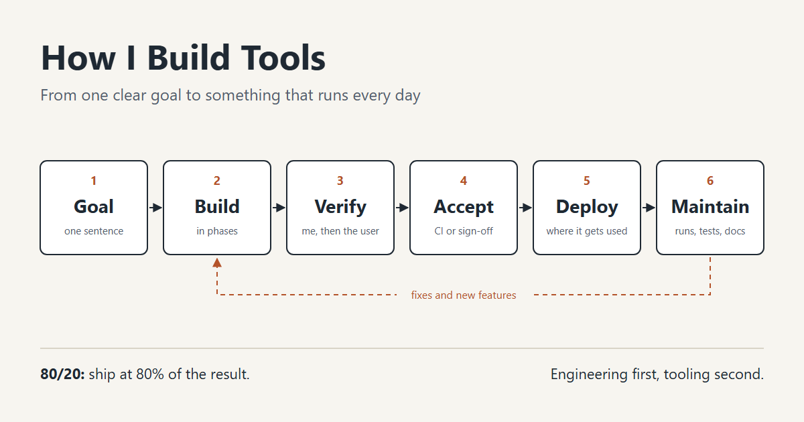
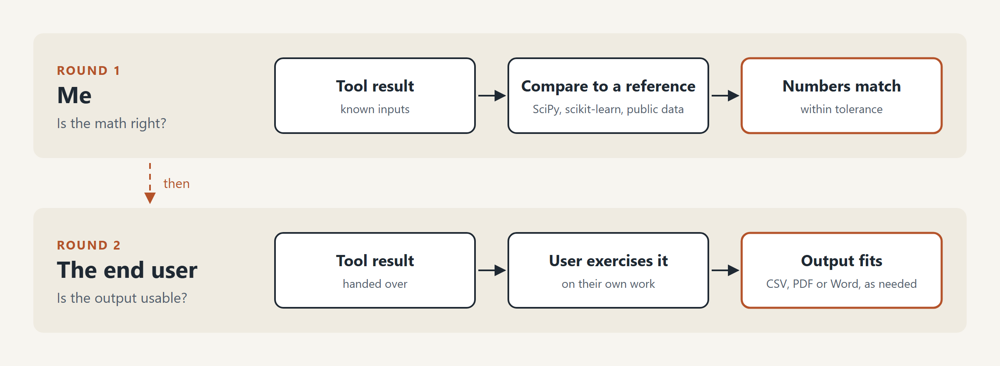

I was asked in an interview how I approach tooling. It was a good question, and nothing on this site answers it. Each post here covers one tool in detail. None of them says what the tools have in common. This is the one page version.

{fig-alt="Six stages of building a tool in a row: goal, build, verify, accept, deploy, maintain, with a loop from maintain back to build for fixes and new features"}

## Start with one goal

Every tool starts as a skeleton and an MVP with a clearly defined goal. Something like "this formula no longer needs a spreadsheet," or "nobody fills in this time sheet by hand anymore." If I cannot say the goal in one sentence, I am not ready to build.

Out of scope is usually not written down at the start. It shows up when I talk to the people who will use the thing, and most of what they add is nice to have. I keep the MVP simple enough that nothing blocks it and nothing in it needs an unreasonable amount of development time. The faster I reach an MVP, the faster I can show something, and a tool people can see is far more likely to get approved than a tool I am describing.

## Build in phases

I build in specific phases so there are markers for progress. A phase is either done or it is not, which is easier to report on than "about 60% there."

I take notes as I go so the gotchas are written down for the next project. Usually that is a markdown file in the repo. Sometimes it is handwritten notes, and sometimes it is complete hell with sticky notes.

## Verify twice

The first round of verification falls on me. That means checking the math against something I did not write: a Python script, or an established Python or JavaScript library. The [DBSCAN visualizer](https://tools.jesse-anderson.net/) is checked against scikit-learn, and [vibes](https://vibes.jesse-anderson.net/) is checked against SciPy and against public bearing data with known faults.

The second round belongs to the end user. Most of what I build is engineering work, so I reach out and have them exercise the tool and verify the outputs on their end. Sometimes everything matches mathematically and the output is still wrong for them. It is a CSV when they needed a PDF, or a PDF when the next step in their process is a Word document. I only find that out by handing it over.

{fig-alt="Two rounds of verification. Round one is me checking the tool's result against a reference library until the numbers match. Round two is the end user exercising the tool on their own work until the output is in a form they can use."}

## Acceptance

If the work is software, acceptance is passing a set of criteria in continuous integration. If it is not, acceptance is sign-off from a manager or whoever owns the process. In a larger organization it can also mean a code review before anything ships.

## Deployment depends on who uses it

For my own tools that means static sites on Cloudflare: [tools](https://tools.jesse-anderson.net/), [the bioreactor controller comparison](https://bioreactor-mpc.jesse-anderson.net/), [the pipe network simulator](https://pipetool.jesse-anderson.net/), [the N-back trainer](https://nback.jesse-anderson.net/). A few have a small hidden backend, and a few sit behind Cloudflare Access because of what they hold. For anything built for someone else, the deployment is whatever that person can actually open and run.

## Maintenance

Ongoing projects get scheduled runs. The [Oak Park crime map](https://opcrime.jesse-anderson.net/) and its [dashboard](https://opcrimeds.jesse-anderson.net/) rebuild continuously, so something yells at me every day, and once a week I look it over to see whether anything is drifting. There are regression tests baked in. The tools site runs its full browser test suite on a weekly schedule for the same reason.

In a larger organization, maintenance also means documentation thorough enough that someone else could edit the tool, or rebuild it, without me. That comes in two parts. The first is a how-to guide for end users, in whatever form they will actually read. It may be an ugly Word document or a tutorial bundled with the tool. The second is a developer guide. Comments in the code help, but the more important thing to write down is why I made a design decision and what I traded off to make it. You can follow code. You cannot always follow what the person writing it intended at that moment, so I document that.

## The 80/20 rule

I follow the 80/20 rule. If a tool gets 80% of the result, I am pretty happy, because getting to 100 takes a lot more work than the first 80 did. So some of my projects are quite fleshed out and still have a few what-ifs left in them. I try not to dwell on the what-ifs. A tool that does 80% of the work and saves a massive amount of time has already done its job.

## Engineering first

None of the above names a language, a framework, or an editor, and that is on purpose. You can give someone all the tooling in the world, but without first principles they get lost the moment there is no tool that maps one to one onto the problem. The engineering comes first, and the tooling is whatever gets it built.
