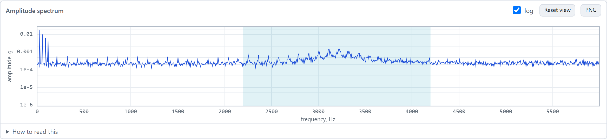
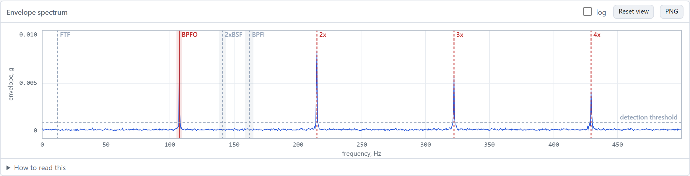

```{=html}
<style>
/* Wide equations and tables scroll inside their own box on narrow screens. */
mjx-container[display="true"] { max-width: 100%; overflow-x: auto; overflow-y: hidden; }
@media (max-width: 767px) {
  main table.table { display: block; overflow-x: auto; }
}
</style>
```

*Disclaimer: Please note that the information presented in this article is for informational purposes only. It is not intended to serve as health advice, engineering advice, or any form of professional guidance. Readers should consult with qualified professionals for specific health or engineering concerns and should not rely solely on the content of this article for making decisions. The authors and publishers of this article are not responsible for any actions taken based on the information provided herein. This article additionally covers a proof-of-concept vibration analysis tool. It is not a certified measurement instrument, and nothing here is a substitute for a trained vibration analyst or for the judgment of whoever is responsible for the machine.*

At one job I was tasked with diagnosing faults in a system that kept failing, and I had nothing to work with. So I fitted it with a variety of sensors to see whether there was some precipitating factor: heat, pressure, anything. It turned out to be vibration.

At another job I got interested in physical automation along the lines of preventative maintenance, and thought it would be cool to model. And during my master's I had run across the NASA bearing data while looking at preventative maintenance datasets for industrial engineering, and filed it away as a good thing to build against.

I made a skeleton of it in 2023, and then it sat on the back burner. I touched it every now and then to tweak this or that, and it never got anywhere. My first attempt had the math coded wrong. I could not tell you which part, because everything was a problem and it all sucked. What came out was noisy, undecipherable nonsense. I did not have the motivation to dig deeper into the math and work out what I was doing wrong.

What made it work in the end was more familiarity with Rust and a better sense of how to build tooling in general. What got it finished was a lengthy work engagement coming up. I wanted my one-offs wrapped up before it started, so I put the finishing touches on this one.

The tool is live at [vibes.jesse-anderson.net](https://vibes.jesse-anderson.net). It takes a raw accelerometer record from a rotating machine, tells you whether a bearing is failing, and names which part of the bearing is damaged. Everything runs in your browser, and the record never leaves your machine.

It runs in a browser tab for a few reasons. There is no server for me to run or pay for. There is nothing to install, so anyone I send the link to can open it. I already had the pattern from [linreg-core](https://jesse-anderson.net/linreg-core/), which runs a Rust core as WebAssembly on my site. And I wanted to find out whether a full diagnostic chain like this was even feasible in a browser.

 gets to.](vibes_overview.png){fig-alt="The vibes page: a record panel on the left, then a severity bar reading 0.77 mm/s zone A, a diagnosis reading BPFO at 107.38 Hz, and waveform, amplitude spectrum and envelope spectrum plots."}

This post covers the reasoning: the physics that makes the problem hard, the math that solves it, the handful of decisions that keep it fast, and the places where real data told me I was wrong.

**Table of Contents**

[The Short Version](#ShortVersion)

1.  [Why the Fault Hides](#Section1)

2.  [Predicting Where to Look](#Section2)

3.  [A Spectrum You Can Read a Number Off](#Section3)

4.  [Stripping the Carrier](#Section4)

5.  [Turning a Plot Into an Answer](#Section5)

6.  [Trending, and Why the Alarm Lines Are in Log Space](#Section6)

7.  [Velocity, and the Guard You Cannot Skip](#Section7)

8.  [Coding for Performance](#Section8)

9.  [What It Is Built On, and What Checks It](#Section9)

10. [What Real Data Said](#Section10)

11. [Where This Goes](#Section11)

12. [Lessons Learned](#Section12)

## The Short Version {#ShortVersion}

A damaged bearing produces a train of tiny hammer blows. The rate of the blows tells you which part is damaged, and that rate is low (around 100 Hz). The energy of each blow rings the machine housing at a high frequency (a few kHz). So you band-pass around the ringing, take the envelope to strip the ringing away, FFT the envelope, and look for a peak at a frequency the bearing geometry predicts, with its harmonics lined up behind it. The numerical core is Rust compiled to WebAssembly, it runs in a Web Worker, and the page only ever holds enough points to fill the pixels on screen. On the Case Western bearing dataset it names the labeled fault and lands within 0.31% of the frequency the geometry predicts. On naturally worn bearings it detects the degradation well and names the damaged part poorly.

Everything below is the why, plus the parts that went wrong.

## 1. Why the Fault Hides {#Section1}

A reasonable first guess is that a bearing fault at 107 Hz shows up as a peak at 107 Hz. It does, technically, and you will never find it. The record looks roughly like this:

$$
\begin{aligned}
x(t) = {} & \underbrace{\sum_{h=1}^{H} \frac{A}{h}\sin(2\pi h f_r t + \varphi_h)}_{\text{shaft and its harmonics}} \\
& + \underbrace{\sum_{k} I\, e^{-\zeta\omega_n (t - t_k)} \sin\!\big(\omega_n (t - t_k)\big)\, u(t - t_k)}_{\text{impacts ringing the housing}} \\
& + \text{noise}
\end{aligned}
$$

with impact times $t_{k+1} = t_k + \frac{1}{f_d}(1 + \epsilon_k)$.

Where:

-   $x(t)$ is the acceleration the sensor records at time $t$.
-   $f_r$ is the shaft rate in Hz, which is rpm divided by 60.
-   $A$ is the amplitude of the imbalance at shaft rate. Harmonic number $h$ has amplitude $A/h$ and its own phase $\varphi_h$, and $H$ is how many harmonics are included.
-   $I$ is the peak amplitude of one impact.
-   $t_k$ is the time of impact number $k$.
-   $\omega_n$ is the natural frequency of the housing resonance, in radians per second.
-   $\zeta$ is the damping ratio of that resonance. A larger value means the ringing dies away faster.
-   $u(t - t_k)$ is a unit step: zero before the impact and one after it, so each ring starts at its own impact.
-   $f_d$ is the defect frequency in Hz, meaning how often the defect is struck.
-   $\epsilon_k$ is a small random number, different for every impact, that stands for slip.

The first term is imbalance at shaft rate $f_r$. The second is the fault: every $1/f_d$ seconds a rolling element strikes the defect, and the housing rings at its natural frequency $\omega_n$ and decays with damping ratio $\zeta$. In the demo record the app loads on startup, $A = 0.02$ g and $I = 0.08$ g. Each blow peaks about four times higher than the imbalance, and the fault still loses. The imbalance puts all of its energy into one sharp line. A blow rings for a few milliseconds, so its energy is spread across a broad hump around the resonance that tops out near 0.001 g, more than ten times below the shaft line. And at 107 Hz there is nothing to see at all. The nearest features are shaft harmonics at 90 and 120 Hz.

The term $\epsilon_k$ is slip. Rolling elements slide a little as they roll, so the spacing between impacts wanders by a percent or two. The low harmonics of the impact rate are weak to begin with and easily masked. Up near the resonance, where the energy is, even a small amount of slip smears the harmonics into each other. Slip also means you can never look for the fault at an exact frequency, which I come back to in [section 5](#Section5).

The fault shows up in the *modulation* of the ringing. The carrier is at $\omega_n$, up where nothing else lives, and it switches on and off at $f_d$. It is the same arrangement as AM radio, with the housing resonance as the station and the bearing as the program.

{fig-alt="Amplitude spectrum from 0 to 6 kHz on a log axis. Four sharp peaks below 150 Hz, a flat noise floor, and a broad low hump centered near 3200 Hz inside a shaded band from 2200 to 4200 Hz."}

{fig-alt="Envelope spectrum from 0 to 500 Hz. Sharp peaks at 107, 215, 322 and 429 Hz, marked BPFO, 2x, 3x and 4x, standing far above a dashed detection threshold. Markers for FTF, 2xBSF and BPFI have no peaks."}

## 2. Predicting Where to Look {#Section2}

None of the math in this post came easily, and this is the section I would least want to explain out loud. Some of this math was pretty goddamn hard to find, and harder to validate once I had it. I am adapting it for a tool here, and I am not trying to write a paper on it, so if you want the derivation, I would send you to the references at the end. Randall and Antoni's tutorial gives these four formulas as its equations 1 to 4, along with the note that real bearings slip by 1 to 2%. Randall's textbook derives them properly. Smith and Randall's benchmark study applies them to the exact dataset I use here. And the Case Western Bearing Data Center publishes the answers for its own bearings, which is what you can check your arithmetic against. What follows is what the tool uses.

There are four defect frequencies, and all of them are built from one ratio:

$$
r = \frac{d}{D}\cos\phi
$$

Then the four frequencies are:

$$
\begin{aligned}
\text{FTF} &= \frac{f_r}{2}\,(1 - r) \\[4pt]
\text{BPFO} &= \frac{n f_r}{2}\,(1 - r) \\[4pt]
\text{BPFI} &= \frac{n f_r}{2}\,(1 + r) \\[4pt]
\text{BSF} &= \frac{D f_r}{2d}\,(1 - r^2)
\end{aligned}
$$

Where:

-   $f_r$ is the shaft rate in Hz, which is rpm divided by 60.
-   $n$ is the number of rolling elements (balls or rollers) in the bearing.
-   $d$ is the diameter of one rolling element.
-   $D$ is the pitch diameter: the diameter of the circle that runs through the centers of the rolling elements. It only has to be in the same unit as $d$.
-   $\phi$ is the contact angle, the angle of the load from the radial plane. It is zero for a deep-groove ball bearing carrying a radial load.
-   $r$ is the ratio defined just above.
-   FTF is the fundamental train frequency: how fast the cage carries the elements around, a bit under half of shaft speed.
-   BPFO is the ball pass frequency of the outer race: how often an element passes a fixed point on the outer race.
-   BPFI is the ball pass frequency of the inner race: how often an element passes a fixed point on the inner race.
-   BSF is the ball spin frequency: how fast one element spins on its own axis.

One check you can do in your head is that $\text{BPFO} + \text{BPFI} = n f_r$ exactly.

Divide any of these by $f_r$ and what is left depends only on the geometry of the bearing. That is the multiplier: a fixed number for a given bearing, which you multiply by whatever the shaft rate happens to be. Bearing makers and the Case Western page publish the multipliers, so the table below shows both.

Worked for the Case Western drive-end bearing (SKF 6205, $n = 9$, $d = 0.3126$ in, $D = 1.537$ in, $\phi = 0$) at 1797 rpm:

| Frequency             | Multiplier | At 29.95 Hz |
|-----------------------|------------|-------------|
| FTF (cage)            | 0.398308   | 11.93 Hz    |
| BPFO (outer race)     | 3.584776   | 107.36 Hz   |
| BPFI (inner race)     | 5.415224   | 162.19 Hz   |
| BSF (ball spin)       | 2.356722   | 70.58 Hz    |
| 2 x BSF (ball defect) | 4.713443   | 141.17 Hz   |

The check I lean on is the Case Western Bearing Data Center, which publishes the multipliers for its own bearings: 5.4152 for the inner ring, 3.5848 for the outer ring, 0.39828 for the cage and 4.7135 for the rolling element. The values in the table agree with those to within 0.01%. That is somebody else's arithmetic on the same bearing agreeing with mine.

None of these is an integer multiple of shaft rate, which is what separates a bearing fault from imbalance, misalignment and looseness. Ball spin frequency needs a note of its own, and the tutorial has one. BSF is how often a fault on a rolling element strikes the *same* race. In between, it strikes the other race, so in general there are two shocks per spin period. The tutorial's conclusion is that the even harmonics of BSF are often the dominant ones, in envelope spectra in particular. That is why the table has a row for $2 \times \text{BSF}$, why the tool searches for both, and why a published table that says "ball" or "rolling element" usually means $2 \times \text{BSF}$. Nothing warns you if you get that factor wrong.

Every one of these scales linearly with shaft speed, so if you enter the wrong rpm, every answer is off by the same proportion.

## 3. A Spectrum You Can Read a Number Off {#Section3}

An FFT hands back complex bins in arbitrary units. For the plot to be worth anything, a sine of amplitude $a$ has to read $a$. The scaling is:

$$
A[k] = \frac{2\,|X[k]|}{N \cdot \text{CG}}, \qquad \text{CG} = \frac{1}{N}\sum_{i} w[i]
$$

Where:

-   $A[k]$ is the amplitude at frequency bin $k$, in the units of the record.
-   $k$ is the bin index. Bin $k$ sits at frequency $k f_s / N$, where $f_s$ is the sample rate.
-   $X[k]$ is the FFT of the windowed record at bin $k$, a complex number, and $|X[k]|$ is its magnitude.
-   $N$ is the number of samples in the record.
-   $w[i]$ is the value of the window at sample $i$.
-   CG is the coherent gain, which is the average value of the window.

The 2 folds the negative-frequency half onto the positive half (DC and Nyquist have no mirror partner and are not doubled). CG is the coherent gain, which undoes the attenuation the window applied.

That fixes a tone that lands exactly on a bin. A tone halfway between two bins is the hard case, and here the window choice decides how wrong you are. I measured it:

| Window                              | Half-bin tone reads | Noise bandwidth |
|-------------------------------------|---------------------|-----------------|
| None                                | 36.3% low           | 1.00 bins       |
| Hann                                | 15.1% low           | 1.50 bins       |
| Flat-top (the SciPy and MATLAB one) | 0.112% low          | 3.77 bins       |
| HFT95                               | 0.044% low          | 3.81 bins       |

This table is why the tool does not use the standard flat-top. I had written the acceptance criterion as flat-top amplitude of an off-bin tone within 0.1%, before writing any code, and the standard flat-top misses it at 0.112%. I confirmed my implementation matched SciPy to sixteen digits, so the shortfall came from the coefficients. The two ways out were to loosen the tolerance or find a better window. I swapped in HFT95 from Heinzel, Rüdiger and Schilling (2002). Its worst case over all offsets is about 0.05%.

For trending you want power in a band, and peak amplitude is a bad proxy because it jumps as a tone drifts between bins. Band power is:

$$
P_{[f_1, f_2]} = \frac{1}{\text{NENBW}} \sum_{k = k_1}^{k_2} c_k\,A[k]^2, \qquad
\text{NENBW} = \frac{N \sum w^2}{\left(\sum w\right)^2}
$$

Where:

-   $P_{[f_1, f_2]}$ is the mean-square content between frequencies $f_1$ and $f_2$, in the units of the record squared.
-   $k_1$ and $k_2$ are the first and last bins inside that band.
-   $A[k]$ is the amplitude at bin $k$, from the equation above.
-   $c_k$ is $\tfrac{1}{2}$ for every bin except DC and Nyquist, where it is 1.
-   NENBW is the normalized equivalent noise bandwidth of the window, in bins.
-   $w$ is the window, and both sums run over all $N$ samples of it.

The half in $c_k$ converts a peak amplitude to mean-square: a sine of amplitude $a$ carries $a^2/2$. A window smears one tone across several bins, so summing them overcounts by exactly the noise bandwidth. Dividing it back out makes the number the same under any window, and it makes time-domain RMS equal spectral RMS (Parseval), which is one of the checks the app runs on itself.

## 4. Stripping the Carrier {#Section4}

The envelope comes from the analytic signal $z(t) = x(t) + j\,\mathcal{H}\{x\}(t)$, whose magnitude $|z(t)|$ is the instantaneous amplitude. Computing a Hilbert transform directly is awkward. In the frequency domain it is three lines:

$$
Z[k] =
\begin{cases}
X[k] & k = 0 \text{ or } k = N/2 \\
2X[k] & 0 < k < N/2 \\
0 & \text{negative frequencies}
\end{cases}
$$

$$
e[i] = \big|\,\text{IFFT}(Z)[i]\,\big|
$$

Where:

-   $x(t)$ is the record and $z(t)$ is its analytic signal, a complex signal whose real part is $x(t)$.
-   $j$ is the imaginary unit and $\mathcal{H}\{x\}$ is the Hilbert transform of $x$, which shifts every frequency component by 90 degrees.
-   $X[k]$ is the FFT of the record at bin $k$, with no window applied.
-   $Z[k]$ is the spectrum of the analytic signal at bin $k$.
-   $N$ is the number of samples, so bin $N/2$ is the Nyquist bin.
-   $e[i]$ is the envelope at sample $i$.
-   IFFT is the inverse FFT, and the bars take the magnitude of a complex number.

Delete the negative frequencies, double the positive ones, invert. On a test signal $(1 + m\cos\omega_m t)\cos\omega_c t$, which is a carrier at $\omega_c$ whose amplitude is modulated at $\omega_m$ with depth $m$, this recovers the modulation $1 + m\cos\omega_m t$ to about $3 \times 10^{-13}$.

The band-pass is *also* a mask on those same bins, so the filter and the envelope are one operation:

$$
Z[k] = 2X[k] \cdot \mathbb{1}\big[k_{lo} \le k \le k_{hi}\big]
$$

Where:

-   $\mathbb{1}[\cdot]$ is 1 when the condition inside it holds and 0 otherwise.
-   $k_{lo}$ and $k_{hi}$ are the first and last bins of the demodulation band.
-   $X[k]$ and $Z[k]$ are as above.

That is one forward real FFT, one mask and one inverse complex FFT. There is no filter to design, no phase distortion, and the rejection outside the band is limited only by floating point (it measures 339 dB against a requirement of 60). The cost is ringing at the band edges and wrap-around at the record ends. Both are confined to a few samples and neither moves a repetition rate, which is the only thing being measured.

This is the "Hilbert transform" method from Randall and Antoni's tutorial, which points out that taking a band out of a one-sided spectrum acts as an ideal filter. The tool departs from the tutorial in one place. The tutorial recommends analyzing the *squared* envelope, because taking the square root adds components that were not in the signal. The tool transforms the envelope itself.

One more step: subtract the mean of the envelope before transforming it. An envelope is strictly positive, so its mean is large and will bury the first few bins, which is where the cage frequency lives.

## 5. Turning a Plot Into an Answer {#Section5}

At this point you have an envelope spectrum with peaks in it and a list of predicted frequencies. Matching them is where the first version called a fault on a healthy bearing.

### Step 1 - Find the fundamental inside a slip window

Search a window of a couple of percent either side of the predicted frequency $f_d$ for the largest bin. That is wide enough to cover normal slip. Refine it with a three-point parabolic fit through the peak bin and its neighbors:

$$
\delta = \frac{1}{2}\cdot\frac{A_{k-1} - A_{k+1}}{A_{k-1} - 2A_k + A_{k+1}}, \qquad \hat{f} = (k + \delta)\,\Delta f
$$

Where:

-   $A_k$ is the amplitude at the peak bin $k$, and $A_{k-1}$ and $A_{k+1}$ are its two neighbors.
-   $\delta$ is how far the true peak sits from bin $k$, in bins, between $-\tfrac{1}{2}$ and $\tfrac{1}{2}$.
-   $\Delta f$ is the bin spacing in Hz, which is the sample rate divided by the number of samples.
-   $\hat{f}$ is the refined frequency of the peak in Hz.

That removes most of the half-bin quantization, which matters when the whole claim is a deviation of a few tenths of a percent.

### Step 2 - Score it against its neighbors

Prominence is the peak over the *median* of the surrounding bins:

$$
p = \frac{A_{\text{peak}}}{\operatorname{median}\{A[k] : k \in \text{neighborhood, excluding the search window}\}}
$$

Where:

-   $p$ is the prominence, a plain ratio with no units.
-   $A_{\text{peak}}$ is the amplitude of the peak found in step 1.
-   The median is taken over the amplitudes $A[k]$ of the bins in the neighborhood.

The neighborhood is a wider stretch of spectrum either side of the search window. I use a median because that neighborhood is full of other discrete peaks, and a mean gets dragged up by whichever one happens to land there.

### Step 3 - Pin the harmonics to the measured fundamental

This is the fix for the false call. Slip moves the whole family together. Once the fundamental is measured at $\hat{f}$, the harmonics are at $2\hat{f}, 3\hat{f}, \ldots$ and there is nothing left to search for. So harmonics get a much tighter window than the fundamental. My first version re-searched every harmonic across the full slip window, which let four unrelated peaks in a busy spectrum pass as a family. Measured on the Case Western records, a real family agrees with itself about twenty times more closely than a coincidental one does, and the window sits between the two.

### Step 4 - Require the fundamental and a family behind it

A fault is called only if the fundamental clears a prominence threshold and enough of its harmonics clear it too. On the same records the fundamental's prominence on a labeled fault is more than twenty times what it is on the healthy baseline. Harmonic count alone does not separate them at all.

### The worst bug

On a record of all zeros, the peak is zero and the median is zero, and I had $0/0$ reading as infinite prominence. A record of zeros, which is what an unplugged sensor produces, was diagnosed with a cage fault and five harmonics. Naming a fault on a machine the sensor is not even attached to is about the worst thing this tool could do. A peak over a silent floor is still infinitely prominent (that is what makes a noiseless synthetic record diagnosable), and silence over silence is now zero. There is a test for each case.

## 6. Trending, and Why the Alarm Lines Are in Log Space {#Section6}

A single record only tells you about one moment, and the useful question in a plant is whether the machine is getting worse. That means trending one number across many captures. The alarm lines come from an early stretch of the sequence, taken as the healthy baseline:

$$
\text{warn} = \exp(\mu + k_1\sigma), \qquad \text{alarm} = \exp(\mu + k_2\sigma), \qquad \mu, \sigma \text{ of } \ln(\text{baseline values})
$$

Where:

-   $\mu$ is the mean of the natural log of the baseline values, and $\sigma$ is their standard deviation.
-   $k_1$ and $k_2$ are how many standard deviations above the mean each line sits, with $k_1 < k_2$ and both a few standard deviations.
-   warn and alarm are the two lines drawn on the trend. The $\exp$ puts them back in the units of the feature being trended.

Vibration amplitudes are roughly log-normal, so thresholds worked out on the raw values end up in the wrong place.

Two of the classic features are traps. Kurtosis ($m_4 / m_2^2$, where $m_2$ and $m_4$ are the second and fourth central moments of the record, which reads 3 for Gaussian noise) and crest factor (peak over RMS) both spike when the first isolated impacts appear, then *fall* as the damage spreads and the record stops being impulsive. So on those two numbers, a bearing that is falling apart can look like it is getting better.

### How much warning each indicator gave

I measured this on one NASA run: 984 captures ten minutes apart, ending with one bearing destroyed. The last two captures were taken after the rig had been switched off, which leaves 982 and 163.7 hours of running. The alarm for each indicator is the first point after which its smoothed trend never drops back below the threshold, so a single spike does not count.

| Indicator                                                | Alarms at record | Warning | 12 hour shifts |
|------------------|------------------|------------------|------------------|
| Overall RMS, sigma alarm                                 | 530              | 75.3 h  | 6.3            |
| Envelope band power, BPFO and its harmonics, sigma alarm | 799              | 30.5 h  | 2.5            |
| Overall RMS, fixed multiple of baseline                  | 897              | 14.2 h  | 1.2            |
| Envelope band power, BPFO fundamental only, sigma alarm  | 912              | 11.7 h  | 1.0            |
| Kurtosis, sigma alarm                                    | 947              | 5.8 h   | 0.5            |
| Crest factor, sigma alarm                                | never            |         |                |
| ISO 20816 velocity, zone B (1.4 mm/s)                    | never            |         |                |

The plain overall level gave the most warning, and it needs nothing from the operator. Kurtosis and crest factor behaved the way the trap above predicts. The ISO number never alarmed at all, which [section 10](#Section10) comes back to.

Two rows of that table are the same feature measured two ways, and the gap between them is a bug I shipped. The test suite checked envelope band power summed over the fault frequency and its first few harmonics. The app was trending the fundamental alone, under the same name. That is 11.7 hours of warning against 30.5, because a spreading defect puts a growing share of its energy into the higher orders. The app now sums the harmonics too.

Do not carry these hours over to another machine. This is one bearing on a rig held at constant speed and load for a week, which is the kindest possible condition for a plain RMS trend. [Section 10](#Section10) has what happened on the other bearings.

## 7. Velocity, and the Guard You Cannot Skip {#Section7}

Maintenance standards (ISO 20816) grade machines on velocity in mm/s, and an accelerometer measures acceleration, so the record has to be integrated. In the frequency domain, integrating $m$ times is:

$$
H_m(f) = g(f)\cdot\frac{(-j)^m}{(2\pi f)^m}
$$

Where:

-   $H_m(f)$ is what the component at frequency $f$ gets multiplied by.
-   $m$ is the number of integrations: 1 takes acceleration to velocity, 2 takes it to displacement.
-   $f$ is frequency in Hz.
-   $j$ is the imaginary unit. Multiplying by $-j$ turns the phase back by 90 degrees.
-   $g(f)$ is the high-pass guard, a number between 0 and 1, defined further down.

The $(-j)^m$ is a 90 degree rotation per integration. If you leave it out, the amplitude is still right and the waveform is wrong, and nothing downstream notices until somebody reads a peak-to-peak value off it. As a check, 1 g at 10 Hz is $9.80665 / (2\pi \cdot 10) = 0.15608$ m/s, or 156.08 mm/s.

$g(f)$ is a high-pass guard, and nothing in the code integrates without one. A constant offset $a_0$ in the acceleration integrates to a velocity $v = a_0 t$ and a displacement $s = \tfrac{1}{2}a_0 t^2$ after a time $t$:

| DC offset | Velocity after 10 s | Displacement after 10 s |
|-----------|---------------------|-------------------------|
| 0.1 mg    | 9.8 mm/s            | 49 mm                   |
| 1 mg      | 98 mm/s             | 490 mm                  |

The ISO alarm level is around 7 mm/s, and a one milli-g offset is what you get from a *good* accelerometer. On a real Case Western record the largest component below 39 Hz is 0.0227 g at 0.098 Hz, which is drift. Unguarded, it integrates to about 360 mm/s against a real shaft-rate component of 0.055 mm/s, a factor of roughly six thousand.

The guard is a raised cosine that ramps up to a corner frequency $f_c$ chosen for the machine, over a fraction $\tau$ of that corner, so it does not ring like a brick wall:

$$
g(f) = \tfrac{1}{2}\left(1 - \cos\!\left(\pi\,\frac{f - f_c(1-\tau)}{f_c\,\tau}\right)\right) \quad \text{for } f_c(1 - \tau) < f < f_c
$$

Where:

-   $g(f)$ is the guard's gain at frequency $f$.
-   $f_c$ is the corner frequency. At and above it, $g = 1$ and nothing is removed.
-   $\tau$ is the fraction of the corner over which the guard ramps. Below $f_c(1 - \tau)$, $g = 0$ and everything is removed.

The same $1/f$ weighting is the reason the bearing diagnosis always runs on acceleration, whatever the plot is showing. Integrating first would push a 3 kHz resonance down by a factor of 100 relative to a 30 Hz shaft line, which throws away the exact band the method depends on. It is also why Figure 1 can show a severity reading in zone A sitting above a called bearing fault. Severity is a velocity number, and velocity barely sees a 3 kHz resonance.

## 8. Coding for Performance {#Section8}

The goal was that moving a control feels immediate. I timed the worst case, a full re-analysis: an amplitude spectrum, an envelope spectrum, a fault ranking, the scalar features, a decimated waveform and a band power. These are native timings of the Rust core on my desktop.

| Record                            | Length   | One full analyze | Per second |
|-----------------------------------|----------|------------------|------------|
| The size of a NASA IMS capture    | $2^{14}$ | 1.2 ms           | 820        |
| The size of a Case Western record | $2^{17}$ | 9.0 ms           | 111        |
| Stress case                       | $2^{20}$ | 74 ms            | 13.6       |

A frame at 60 Hz is 16.7 ms, so on paper everything a real record needs fits inside one. That table is the benchmark I optimized against, and it flatters the tool in two ways: every length is a power of two, and none of it is running in a browser. Both get measured properly further down.

The decisions that got it this far, roughly in order of how much they mattered:

**Samples cross into the worker once and never come back.** The DSP runs in a Web Worker so the interface cannot block. The record is handed to the worker without a copy, converted to `f64` in WASM linear memory, and stays there. The main thread holds only arrays sized to the canvas.

**Render cost is a function of pixel width.** A million samples into a 1200 pixel plot is 874 samples per column. Drawing all of them costs main-thread time for a picture no different from drawing a fraction of them. Taking every 874th is worse, because it silently drops the transients an analyst is looking for. Min/max decimation keeps both extremes of every column, so the outline you see is the real outline of the data, and a twenty-million-sample record costs the same to pan as a thousand-sample one.

**A real FFT for real data.** `realfft` packs a length $N$ real record into a length $N/2$ complex transform plus a post-pass, about half the work of padding with zero imaginary parts.

**Hold everything keyed by length.** FFT plans, windows and scratch buffers live in one `Workspace` per worker. The same lengths get transformed over and over as you move a control.

Then I profiled and found three problems.

| At $2^{20}$        | Before  | After   |
|--------------------|---------|---------|
| Amplitude spectrum | 43.5 ms | 14.5 ms |
| Envelope spectrum  | 80.6 ms | 53.1 ms |
| One full analyze   | 128 ms  | 74 ms   |

1.  **The window was regenerated on every call.** A Hann window is a cosine per sample. At a million samples that measured 20 ms, twice the cost of the transform it was preparing for. It is now generated once per kind and length.
2.  **Every transform copied its input twice.** The backend needs a mutable copy, and windowing made another. A $2^{20}$ record of `f64` is 8.4 MB, so that was 16 MB of memory traffic per transform. The window is now applied in the same pass that fills the scratch buffer.
3.  **The analytic signal was built in full for callers that only wanted its magnitude.** Sixteen bytes a sample allocated, then immediately reduced to eight. There is now a magnitude path over one reused buffer.

A fourth optimization got reverted. Caching the complex buffer behind a function that returns an owned vector forces a copy out, and the copy cost more than the allocation it saved. I only caught it because I timed it.

On timing: within one run I report the *minimum* of repeated calls. Every source of noise on a desktop makes a call slower and none makes it faster, so the fastest call is the best estimate of what the code costs. Comparing two builds needs more care. My desktop has two speed states about 2x apart, and which one a run lands in is luck. My first native against WASM comparison put `wasm-opt` at a 2x speedup, and it was the machine changing state between runs. So for comparisons I interleave the builds over several rounds and take the median.

### Real records = / = powers of two

An FFT is fastest when its length is a product of small primes, and a real record is whatever length the acquisition stopped at. Case Western record 130 is 121,990 samples, which is $2 \cdot 5 \cdot 11 \cdot 1109$. Record 197 is 121,846 samples, which is twice a prime. So I timed one full analyze on the real records, natively and compiled to WASM, and again with each record trimmed to the nearest shorter length with no prime factor above 5.

| Record              | Samples | Largest prime factor | Native  | WASM    |
|---------------------|---------|----------------------|---------|---------|
| Reference, $2^{17}$ | 131,072 | 2                    | 8.2 ms  | 13.8 ms |
| 130 as recorded     | 121,990 | 1,109                | 14.1 ms | 39.5 ms |
| 130 trimmed         | 121,500 | 5                    | 8.4 ms  | 15.6 ms |
| 197 as recorded     | 121,846 | 60,923               | 20.3 ms | 38.6 ms |
| 197 trimmed         | 121,500 | 5                    | 8.3 ms  | 15.8 ms |
| 97 as recorded      | 243,938 | 5,303                | 41.5 ms | 79.6 ms |
| 97 trimmed          | 243,000 | 5                    | 17.8 ms | 34.0 ms |

**The real in-browser number is two to three frames.** A ten second Case Western record as recorded takes 33 to 45 ms per full analyze in WASM. The 9.0 ms in the first table came from a synthetic record of a convenient length on a native build.

**`rustfft` copes with awkward lengths well.** It switches to slower algorithms when a length has a large prime factor. Natively, the bare transform at record 130's length takes about 2x as long as at $2^{17}$. NumPy's FFT takes about 7x as long. In WASM the same comparison is about 4x, which is where the real cost shows up.

**Trimming is the cheapest speedup left.** The tool does not do it yet ([section 11](#Section11)). Dropping about 1% of the samples at most (a tenth of a second off a ten second record) makes a full analyze 1.6 to 2.4x faster natively and 2.1 to 2.8x faster in WASM, which puts a Case Western record back at about one frame. The price is a bin spacing that changes by the same fraction and a sliver of data that goes unused. The NASA captures need nothing: they are 20,480 samples, which is $2^{12} \cdot 5$.

### What compiling to WASM costs

I ran the same Rust functions on the same records, built once natively and once for `wasm32`, and checked that the answers matched:

|                                           | WASM time over native time |
|-------------------------------------------|----------------------------|
| One full analyze, median over all records | 1.9x                       |
| Middle half of the measurements           | 1.7x to 2.3x               |
| The bare FFT alone                        | 2.9x (2.0x to 4.3x)        |

The FFT takes the biggest hit. Natively, `rustfft` detects AVX and SSE at runtime and uses them. Its WASM build is scalar unless you opt in. The rest of the pipeline (windowing, magnitudes, the scalar features, the median sort in the fault search) loses much less, which is how the whole lands under 2x.

**`wasm-opt -O3` made no measurable difference.** 13.4 ms without it and 13.8 ms with it at $2^{17}$, which is inside the noise. It stays in the build because it costs nothing.

**WASM SIMD is a mixed result.** `rustfft` has a `wasm_simd` feature, so I built with it and `simd128`. A full analyze got 1.2 to 1.4x faster at powers of two and at the awkward as-recorded lengths. At the trimmed lengths it got about 10% slower. Trimming is the bigger win and the two do not stack, so SIMD stays off.

One caveat on the method is that the WASM side ran in Node 24, which is the same V8 engine as Chromium and still a different host, and it called the core through plain exports without the `wasm-bindgen` layer the real page uses. The one figure I have from Chromium itself, a $2^{20}$ FFT at 14.4 ms against 8.9 ms native, gives 1.6x, which is in line with the power-of-two rows here.

### What I did not do

My acceptance criterion for speed was a $2^{20}$ FFT under 150 ms, and it passes with a factor of ten to spare. Looking back, that criterion was easier than the real workload: one transform, at a power of two. The margin is why I never reached for threads, which would also require cross-origin isolation headers at deployment.

The largest remaining cost is the full-length inverse transform in the envelope chain (about 30 ms at $2^{20}$). A band-limited analytic signal can be shifted to baseband and inverted at a lower rate, roughly 3x shorter for a 2 kHz band under a 6 kHz Nyquist. I left it alone, because it would put the validated path at risk and trimming is a simpler gain.

The build settings are standard: `opt-level = 3`, link-time optimization, one codegen unit, then `wasm-opt -O3` over the module.

## 9. What It Is Built On, and What Checks It {#Section9}

The source is closed, so this section lists the libraries the numerical work leans on, what I trust them for, and what I used to check my own work against. I kept the list short, since each dependency is more code I did not write and still have to trust.

### What runs in your browser

| Library                                        | What it does here                                                  | Why this one                                                                                                                   |
|------------------------|------------------------|------------------------|
| `rustfft` 6                                    | Complex FFT, forward and inverse                                   | The standard pure-Rust FFT. No C toolchain, so it compiles to WASM cleanly, and it accepts any length ([section 8](#Section8)) |
| `realfft` 3                                    | Real-to-complex and complex-to-real transforms on top of `rustfft` | Half the work for real input ([section 8](#Section8))                                                                          |
| `wasm-bindgen`, `js-sys`, `serde-wasm-bindgen` | The boundary between Rust and TypeScript                           | Generates the type definitions, so a wrong argument type is a compile error                                                    |
| `hyparquet`                                    | Reads Parquet records                                              | Small and pure JavaScript. Its decompressors (`hyparquet-compressors`, about 90 kB) are fetched only when a file needs them    |

There is no UI framework, no charting library and no math library on the JavaScript side. The plots are hand-written Canvas 2D (about 800 lines), the MATLAB `.mat` reader is hand-written with every length checked against the bytes present, and the page builds its DOM with `createElement` and nothing else. The numerical core itself depends on exactly two crates and is marked `#![forbid(unsafe_code)]`.

### What checks the numbers

| Tool                          | Role                                                                                                                                                                     |
|------------------------------------|------------------------------------|
| NumPy 1.26.0 and SciPy 1.16.3 | The independent reference. Sixteen fixture cases generated by `scipy.signal` and `scipy.stats`, and the Rust core has to agree with every one to $10^{-6}$ of full scale |
| Rust's built-in test harness  | The acceptance criteria are ordinary `cargo test` cases against the core as a native library, no browser involved                                                        |
| The in-app Tests tab          | The numerical-core assertions, run again inside the deployed WASM module in your browser                                                                                 |
| Playwright driving Chromium   | More than 70 checks against the built page: what is on screen, what the exports contain, and that no network request carries a body                                      |
| `parquet` (the Rust crate)    | Test-only. Lets the Rust tests read the NASA records in the same format the app ships                                                                                    |

A few details on the SciPy comparison, because "agrees with SciPy" is easy to claim loosely. Both sides build their inputs from the same integer generator with exact power-of-two scaling, so the records are bit-identical and any disagreement belongs to the routine under test. Real and imaginary parts are compared separately, so a conjugation error cannot hide inside a magnitude. The case I value most is the envelope against `scipy.signal.hilbert`, since the analytic signal is the step most easily gotten subtly wrong and SciPy's is an independent implementation. And the versions are pinned in CI to the ones the fixtures were generated with, so a SciPy upgrade cannot move the target unnoticed.

The second run, inside the browser, is there because a native test cannot see a WASM boundary that truncates a float, a build flag that changes rounding, or an optimizer that reorders an accumulation.

### What builds and ships it

| Tool                                                     | Role                             |
|------------------------------------|------------------------------------|
| `wasm-pack` 0.13.1 and `wasm-opt`                        | Rust to an optimized WASM module |
| TypeScript 5, `strict` plus `exactOptionalPropertyTypes` | The application shell            |
| Vite 6                                                   | Bundling                         |
| Cloudflare Workers via `wrangler`                        | Hosting                          |

CI runs Cargo with `--locked`, pins every GitHub Action to a commit, and pins `wasm-pack`, NumPy and SciPy to exact versions.

## 10. What Real Data Said {#Section10}

I wrote fourteen acceptance criteria before writing code. Thirteen pass as written, and the fourteenth turned out to be wrongly worded.

### On seeded faults it works

On three Case Western seeded-fault records the tool calls the right element with five harmonics and lands within 0.31% of the computed frequency. It also declines to call anything on the healthy baseline. (The outer race records ran at 1796 rpm, so their computed frequency is 107.30 Hz, a little under the 107.36 Hz in the [section 2](#Section2) table.) On one record another group (Li et al.) published 107.65 Hz, and I measure 107.64 Hz. That is another group, using another method, reading the same file and landing a hundredth of a hertz away. The two faulty records the tool declines to call fall in the categories that Smith and Randall's benchmark study flags as hard.

### On natural wear my criterion was wrong

The NASA IMS set runs real bearings to natural failure. I had written "band power is monotonically increasing, smoothed" as the criterion. It cannot be met, and no smoothing window fixes it, because a run-to-failure sequence spends most of its life not failing and noise is never monotonic. What does hold is that band power grows 28x over the run and crosses its own alarm with about 30 hours of warning. That figure is for one bearing, though, and on the other bearings in the set that failed the warning ranged from about 5% of the run to under half of it.

Worse, the fault *naming* that works so well on machined defects named one of four naturally worn bearings, and only in its final records. A machined spall is a crisp edge that every rolling element strikes the same way. A bearing worn out at end of life is damaged everywhere at once, the impacts smear together, and the harmonic family is weak. Seeded faults and natural wear are different problems, and I only learned that because I tested on a second dataset.

### ISO velocity never saw the failure

ISO broadband velocity, the number most maintenance programs are built on, never held above zone A ("typical of a newly commissioned machine") across a run that ends with the bearing destroyed.

### What that adds up to

I want to be straight about what this means. "Is this bearing getting worse?" is answered well. "Which part is damaged?" is answered well on seeded faults and is unproven on natural wear.

My reaction to all of this was annoyance. You have to tune the hell out of these things just to get something workable. The demodulation band, the detection threshold and the baseline were each set against one dataset, and each one stopped working on the next. That is why I think you are best off doing regular inspections where you can, and relying on other indicators beyond vibration.

On a new machine with one defect, sure, the method is clean. An old machine is harder, and the reason is in what a sensor measures. It reads the sum of every source in the machine, each one shaped by the path the vibration took to reach it:

$$
x(t) = \sum_i \big(h_i * s_i\big)(t)
$$

Where:

-   $x(t)$ is what the sensor records.
-   $s_i(t)$ is one source of vibration: a bearing, a gear, an imbalance.
-   $h_i(t)$ is the response of the structure between that source and the sensor.
-   $*$ is convolution, which is how a source gets shaped by the path it travels.
-   The sum runs over every source in the machine.

If other parts are wearing out too, they are more terms in that sum. Their impacts ring the same structure, so they land in the same band I am demodulating, where they raise the floor and add peaks of their own. A threshold tuned on a clean machine does not survive that.

The NASA rig shows it. Four bearings share one shaft, and the alarm on overall level also fired on seven of the eight bearings that did not fail. One of those neighbors even read as an outer race fault. It has the same geometry as the failing bearing next to it, so it has the same defect frequencies, and nothing in the frequency says which of the two is damaged.

To be fair to the method, a second worn part with a different geometry has different defect frequencies, so the envelope spectrum can still tell the two apart in principle. That stops working in three cases: the parts share a geometry, as on this rig; the wear is spread out, so the impacts stop being periodic; or two of the frequencies happen to coincide. Distance helps too. High-frequency ringing dies off quickly across joints, so a sensor mounted close to one bearing favors that bearing.

Much of Randall and Antoni's tutorial is about exactly this problem: pulling a weak bearing signal out from under stronger ones from other components, gears in particular. It has techniques for that which this tool does not have YET. Please don't scream at me for not making an infallible tool.

## 11. Where This Goes {#Section11}

This is an MVP and a small hobby project. It had been sitting since 2023, and when I put the finishing touches on it I spent the time on getting the numbers right over making the interface pretty. If I ever end up as a vibration analyst, or have to build this as a legitimate engineering tool, this is the base I would start from.

### What is wrong with it right now

The biggest problem with the tool today is that it is very involved to even understand what is going on. You land on a page of plots and settings, and unless you already know envelope analysis, nothing tells you where to look. This part is a note to my future self more than anything.

Future me, please note that we (you (me)) need to make the following changes:

1.  **Make the page explain itself.** A first-time visitor should be able to tell what the tool concluded, and why, without reading the guide first.
2.  **Take the demodulation band off the user.** Right now you have to know what a structural resonance looks like and Shift-drag over it. That is the hardest step and it comes first. The usual answer is spectral kurtosis and the kurtogram, which the tutorial covers.
3.  **Say so when more than one fault family is called.** The panel names only the top-ranked one.
4.  **Break up the left panel.** Record, acquisition, bearing, severity, analysis and export are all stacked in one long column.
5.  **Add a bearing catalog.** Geometry is three presets or manual entry, and nobody knows their pitch diameter offhand.
6.  **Let people customize it.** Units (g or m/s², Hz or orders or CPM), saved setups per machine, plot colors and layout, and alarm thresholds.
7.  **Trim records to a fast length before transforming them.** [Section 8](#Section8) measured it: a real Case Western record costs two to three frames per analyze in the browser as recorded, and about one frame with at most 1% of its samples dropped.
8.  **Try the squared envelope.** The tutorial recommends it over the plain envelope ([section 4](#Section4)), and I have not measured what it changes.
9.  **Make the high-pass guard's documentation match its code.** The notes say the corner is a required argument with no default. The code gives it one. One of the two has to change.

### Farther out

**A monitor mode.** Point it at a folder, get one verdict and one chart, with no demodulation band to choose. One idea for picking the band automatically (take the slice that grew most against baseline) worked on one dataset and failed on the next, so that step needs more than arithmetic.

**A real-time simulator.** This one is much farther down the road. The idea is a tool that streams simulated data live, so you can evaluate a rotor, its bearings and the rest of a machine as it runs. The repo has a starting point in the signal model from [section 1](#Section1) and a three-phase degradation model (healthy, a discrete spall, spreading damage) that generates the bundled run-to-failure set. The gap is that everything in this post works on a whole record at once. The band-pass in [section 4](#Section4) zeroes bins of a complete transform, which has no meaning for a stream that never ends. Streaming needs block processing that carries filter state across block boundaries, and filters designed for that job.

## 12. Lessons Learned {#Section12}

-   **Write the acceptance criteria first, and do not move them quietly.** One criterion forced a better window. Another turned out to be wrong, and saying so in writing was more useful than passing it.
-   **Test on a second dataset.** Everything I am least confident about came from the second one.
-   **Check what the tool says when it cannot see.** A record of zeros was diagnosed with a fault, and a record containing a NaN was graded zone A. Both now produce an error or no call.
-   **Benchmark at the sizes real data arrives in.** My benchmark used powers of two and a native build. Real records in the browser were about four times slower than the number I had been quoting.
-   **Measure before optimizing, and measure after.** The biggest win was a window being recomputed on every call, and one "optimization" made things slower.
-   **Keep the arithmetic out of the browser layer.** All the math is a plain Rust crate with ordinary tests, and the core assertions run again inside the deployed WASM from a Tests tab. The second run catches things a native test cannot.

That is the tool and the thinking behind it. It is live at [vibes.jesse-anderson.net](https://vibes.jesse-anderson.net), and it loads a demo record on startup, so there is something to poke at before you open a file of your own. Realistically if I were building some sort of tool like this I could set up an insane amount of instrumentation to collect data then use that to tune things while using the published papers as a base, so again, don't yell at me if it isn't perfect for your use case. Or contact me at my email if you want to chat some more about this implementation!

Thanks for reading,

Jesse

## References

**Method**

-   Randall, R. B. *Vibration-based Condition Monitoring: Industrial, Aerospace and Automotive Applications.* Wiley. The place to go for the bearing frequency derivations and for envelope analysis in general.
-   Randall, R. B., Antoni, J. (2011). *Rolling element bearing diagnostics: A tutorial.* Mechanical Systems and Signal Processing 25(2), 485-520. [doi:10.1016/j.ymssp.2010.07.017](https://doi.org/10.1016/j.ymssp.2010.07.017). Equations 1 to 4 are the bearing frequencies, and section 5 is the envelope method used here.
-   Heinzel, G., Rüdiger, A., Schilling, R. (2002). *Spectrum and spectral density estimation by the Discrete Fourier transform (DFT), including a comprehensive list of window functions and some new flat-top windows.* Max Planck Institute. The source of the HFT95 window.
-   ISO 20816, mechanical vibration measurement and evaluation on non-rotating parts. The severity zones.

**Data**

-   Case Western Reserve University [Bearing Data Center](https://engineering.case.edu/bearingdatacenter), *Seeded Fault Test Data.* The published bearing dimensions and multipliers are on its [bearing information page](https://engineering.case.edu/bearingdatacenter/bearing-information).
-   Smith, W. A., Randall, R. B. (2015). *Rolling element bearing diagnostics using the Case Western Reserve University data: A benchmark study.* Mechanical Systems and Signal Processing 64-65, 100-131.
-   Li, W., Qiu, M., Zhu, Z., Jiang, F., Zhou, G. *Fault diagnosis of rolling element bearings with a spectrum searching method.* arXiv:1511.03174. The independently published 107.65 Hz reading.
-   Lee, J., Qiu, H., Yu, G., Lin, J. and Rexnord Technical Services (2007). *Bearing Data Set*, IMS, University of Cincinnati. NASA Prognostics Data Repository, NASA Ames Research Center, Moffett Field, CA.